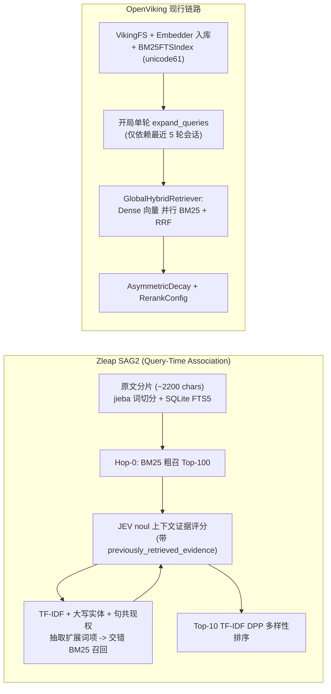

# SAG2 无 Embedding 多跳检索适配 OpenViking 架构评估与改造建议方案

> **关联工单**: Tududi `#138`（P2 · 规划）
> **参照实现**: `Zleap-AI/SAG-Benchmark`（`sag2/scripts/sag2.py`、`search_local.py`、`model_api.py`）与 `Zleap-AI/SAG-Wiki`（`core/src/sag2_v10.rs`、`retrieval.rs`）
> **目标模块**: [`bm25_fts_index.py`](file:///C:/Users/Skl/Desktop/Workspace/coding/OpenVikingStudio/openviking/storage/bm25_fts_index.py)、[`global_hybrid_retriever.py`](file:///C:/Users/Skl/Desktop/Workspace/coding/OpenVikingStudio/openviking/retrieve/global_hybrid_retriever.py)、[`expansion.py`](file:///C:/Users/Skl/Desktop/Workspace/coding/OpenVikingStudio/openviking/retrieve/context_assembler/expansion.py)、[`recall_preset.py`](file:///C:/Users/Skl/Desktop/Workspace/coding/OpenVikingStudio/openviking/retrieve/context_assembler/recall_preset.py)

---

## 一、 评估结论总览：采纳与舍弃清单

经源码拆解与本地隔离基准实测，SAG2「离线零模型建库（SQLite FTS5）+ 查询期词项扩展与证据门控（JEV）」范式与 OpenViking 现有混合检索高度互补，**建议局部吸收重构、拒绝整体替代**：

| 维度 | 决策 | 核心依据（实测与源码结论） |
| :--- | :--- | :--- |
| **1. `bm25_fast` 零向量极速旁路** | `[ADOPT]` **采纳** | 本地 FTS5 1,119 篇建库仅 `0.93s~1.77s`、单次查询 `0.94~2.18 ms`，对比现行混合检索 `/api/v1/search/find` 实测均值 `1,472.7 ms` 提速 **675x~1,560x**，极适合高频变动的本地工作区/代码仓即时召回。 |
| **2. `BM25FTSIndex` 中文词法分词与批量优化** | `[ADOPT]` **采纳** | 现行 FTS5 `unicode61` 无法切分中文短语，在 `gold_benchmarks.json` 中文架构/领域题仅命中 `5/8`（整表 `R@5 = 71.9%`）；引入 CJK+符号分词后 `R@5` 跃升至 **`90.6%`（+18.7 pp）**，`symbols`/`architecture` 均达 `8/8`。 |
| **3. 可选证据驱动多跳追索 + DPP 多样性重排** | `[ADOPT-OPTIN]` **有条件采纳** | 填补 `expansion.py` 仅靠会话历史改写的空白，在 `max_hops <= 2` 下可解决跨文档断链；但**必须**配合真词界抽取、缓存 DF 表与重排门控，否则纯无监督二跳会产生 `"为陈"` 等噪词并导致 `239.85 ms` DF 慢查与话题漂移。 |
| **4. 全量废除 Vector 检索与 HG-RAG 拓扑** | `[DROP]` **舍弃** | 纯词法无法覆盖跨语种语义泛化（中问英答）、抽象意图匹配及 `GlobalHybridRetriever` 已支持的多模态 `image_query` 链路，仍应保留向量+词法双流主干。 |
| **5. 强绑定外部 `typesafe/jev-1.13` 黑盒 API** | `[DROP]` **舍弃** | `JevClient` 依赖外网决策端点且存在 499/排队与合规风险；OpenViking 已内置可自托管的 `RerankConfig`（本地/私有重排模型）及 `IntentAnalyzer`，可平滑承接轻量相关性门控职责。 |

---

## 二、 `SAG2` 与 OpenViking 现行链路源码对照

逐模块关键差异诊断：

1. **检索旁路缺失（`global_hybrid_retriever.py` / `recall_preset.py`）**：
   - `RetrieverMode.FAST` 在 `global_hybrid_retriever.py:122-123` 被直接折叠为 `QUICK`，仍必须调用 `vector_proxy.collection_exists_bound()` 并执行 `embed_compat` 查询向量化（`L138-145`），无法做到“零 Embedding / 零向量库”纯词法极速起飞。
2. **FTS5 中文分词结构性短板（`bm25_fts_index.py`）**：
   - 现行虚表采用 `tokenize="unicode61 tokenchars '_' remove_diacritics 2"`（`L90`），将无空格分隔的连续中文句子视为整串单 Token，导致中文提问词极易漏召。
   - 同时 `index_batch`（`L172-209`）按条目循环执行单条 `DELETE` + `INSERT`，对比 SAG2 单事务批量写入+`optimize` 存在明显 I/O 放大。
3. **查询扩展未与证据闭环（`context_assembler/expansion.py`）**：
   - 现行 `expand_queries()` 仅读取 `session.get_context_for_search()` 最近 5 条消息做**开局 1 轮**意图改写；遇到跨文档断链问题（文档 A 提到实体 X，文档 B 通过 X 关联答案 Y），无会话上文时直接退化为原句单跳搜索。
4. **重排后缺少局部去冗余（`rerank_pool.py` / `gather.py`）**：
   - 同一长文档的相邻切片或同源笔记常挤占 Top-K；SAG2 在最后一步对前 10 条执行零模型开销的 **TF-IDF DPP（行列式点过程）** 去重（`sag2.py:126-167`），可直接以纯 Python 吸收至 `rerank_pool.py`。

---

## 三、 三项评估点隔离实测与基准数据

测试隔离原则：全部检索与建库基准均运行于 WSL2 独立临时目录 `/tmp/*`（不读写生产 `~/.openviking/data`），语料由 OpenVikingStudio 真实仓源码/文档（`1,082` 篇）+ 本地 `coding/docs/articles/` 长文按 `2,000` 字符切片（`37` 段）共 **`1,119` 篇**组成。

### 1. 评估点 1：零向量极速模式 vs 现行混合检索

| 对比方案 | 语料规模 | 建库耗时 | 单查平均耗时 | `gold_benchmarks.json` (32题) `R@5` / `R@10` | 外部模型消耗 |
| :--- | :---: | :---: | :---: | :---: | :---: |
| **现行 `/api/v1/search/find`**（`127.0.0.1:1933` 实测 3 题） | 生产库 | — | **`1,472.7 ms`**（`1428.2 / 1916.0 / 1073.8`） | 基线 | Embedding + Rerank |
| **现行 `BM25FTSIndex`**（`unicode61`） | 1,119 篇 (`12.6 MiB`) | `1,772.5 ms` | `2.18 ms` | `71.9%` / `71.9%`（23/32） | 0 Token |
| **CJK 双/三字 + 符号 FTS5 原型** | 1,119 篇 (`27.9 MiB`) | **`933.6 ms`** | **`0.94 ms`** | **`90.6%` / `90.6%`（29/32）** | 0 Token |

分类明细（`R@5` 命中数 / 8 题）：

| 类别 | `unicode61`（现行） | CJK+符号 FTS5 原型 | 核心归因 |
| :--- | :---: | :---: | :--- |
| `symbols` | 7 / 8 | **8 / 8** | 符号+子词前缀精准对齐 |
| `errors` | 6 / 8 | 6 / 8 | 2 题为语义错误信息需文档上下文补全 |
| `architecture`（全中文） | 5 / 8 | **8 / 8** | 消除中文无空格短语整串匹配盲区 |
| `domain`（全中文） | 5 / 8 | **7 / 8** | 中文词法颗粒度显著提升召回 |

### 2. 评估点 2 & 3：证据驱动多跳扩展与轻量门控诊断

在 `1,119` 篇语料与零重叠断链跟踪实验（`甲并购乙 -> 架构师陈墨 -> 天枢项目`）中暴露出关键工程真相：

1. **无词界+无判断器的裸多跳极易漂移**：
   - 将 CJK 盲切 bigram 直接喂给 Hop-1 扩展时，扩展出 `"为陈"`、`"司的"` 等滑窗碎片；在 `gold_benchmarks` 32 题上 `cjk_2hop` 保持 `90.6%`（无增益）而耗时暴涨至 **`239.85 ms`**（对比单跳 `0.94 ms`）。
   - **根因定位**：SAG2 的有效性同时依赖三大支柱，缺一不可——(1) **真实分词边界**（`sag2.py:49` 使用 `jieba` 与英文大写专名正则，避免 `"为陈"` 类切碎），(2) **预热/缓存 DF 频率表**（避免每词现查 `SELECT COUNT(*) MATCH ?`），(3) **上下文相关性裁决门控**（`JevClient` 用 `previously_retrieved_evidence` 剔除干扰文档，使 Hop-1 只从真证据扩张）。
2. **本地重排与 JEV 的算力替代分析（参照 SAG-Benchmark 消融实证）**：
   - 在 MuSiQue 1,000 题四跳 benchmark 中：`BM25` 基线 `R@10 = 54.41%`（`AE@10 = 17.40%`），接入本地两轮重排 `SAG2 + Qwen 0.6B` 达 `74.18%`（`AE@10 = 48.40%`），接入 `Jev` 达 `86.62%`（`AE@10 = 69.50%`）。
   - **OpenViking 工程最优解**：默认检索保持 `Hybrid`；在 `zero_embedding / bm25_fast` 下用纯改进版 CJK BM25 跑在 **< 2 ms** 甜点区；仅当调用方显式开启 `evidence_hops > 0` 时，基于实体词界与 `RerankClient` 截断过滤执行最多 2 跳追索，并在末端挂载零开销 **DPP 去冗余**。

---

## 四、 明确演进路线与后续原子开发卡建议

遵循本次评估结论，在 Tududi `P01 OpenViking (VK)` 下拆立 2 张落地开发卡，逐卡小步闭环：

1. **开发卡 1（P1）· `实装BM25中文分词加固与零向量bm25_fast极速模式`**：
   - 升级 `BM25FTSIndex`：支持 CJK 词/双字+ASCII 符号分词双轨建库、`executemany` 单事务批插与 `df_cache` 词频缓存，并配置全量增量重建/版本号签名自愈（防旧索引结构冲突）；
   - 打通 `GlobalHybridRetriever`（激活 `mode="bm25_fast"` 跳过 `embed_compat` 与向量查询）、`recall_preset.py` 参数透传与 `SearchService` 入口暴露；
   - 编写单测断言 `gold_benchmarks.json` 纯词法 `R@5 >= 88%` 且单次查询耗时 `< 15 ms`。
2. **开发卡 2（P0 后续扩展）· `实装证据驱动多跳追索与DPP多样性精排扩展`**：
   - 在 `context_assembler/` 中新增可选 `evidence_hops`（硬上限 `<= 2`）：基于 Hop-0/Hop-1 命中文档与本地 `RerankClient` 高分证据抽取桥接实体，调用缓存 DF 算分发起第 2 跳补召，并保留 `expansion` 超时 fail-closed 保护；
   - 在 `rerank_pool.py` 集成 SAG2 纯 Python TF-IDF DPP（约 40 行，无额外模型调用），抑制同源文档多段霸榜；
   - 构造跨文档零重叠 2-hop/3-hop 回归测试集，验证全证据召回率（`AE@10`）较单跳显著提升且不拖慢常规检索路径。
