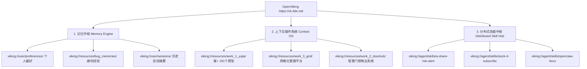

# 🧠 OpenViking (VK) 体外大脑与技能中枢高级玩法手册

> **服务基准地址**：`https://vk.tide.red`  
> **核心定位**：AI Agent 跨会话记忆库 + 语义上下文操作系统 (Context OS) + 分布式技能云中枢 (Skill Hub)

---

## 目录
- [一、 OpenViking 三位一体架构全景](#一-openviking-三位一体架构全景)
- [二、 玩法一：跨会话与跨设备记忆自动传承](#二-玩法一跨会话与跨设备记忆自动传承)
- [三、 玩法二：分布式云端 Agent 技能中枢](#三-玩法二分布式云端-agent-技能中枢)
- [四、 玩法三：多项目隔离与命名空间路由](#四-玩法三多项目隔离与命名空间路由)
- [五、 玩法四：踩坑经验与用户偏好持久化](#五-玩法四踩坑经验与用户偏好持久化)
- [六、 玩法五：自动化 Git / CLI 增量同步 Hook](#六-玩法五自动化-git--cli-增量同步-hook)
- [七、 玩法六：层级摘要渐进式 RAG 检索](#七-玩法六层级摘要渐进式-rag-检索)
- [八、 常用 CLI 快捷命令行速查](#八-常用-cli-快捷命令行速查)

---

## 一、 OpenViking 三位一体架构全景



---

## 二、 玩法一：跨会话与跨设备记忆自动传承

> **痛点**：每次重新开启聊天窗口或换一台电脑，AI Agent 都会“失忆”，必须重新发送背景资料。

### 💡 解决方案：
1. **会话结束自动提交**：每次完成一个重大专案（如干部公寓天数算法核算），自动生成 `session_summary.md` 上传至 OpenViking：
   ```bash
   python 02_IT系统开发与功能需求/openviking_client.py upload "scratch/session_summary.md" --to "viking://user/sessions/session_20260804_yujia.md"
   ```
2. **新会话自动热加载**：新开启会话的第一时间，AI Agent 自动检索 `viking://user/sessions/`，**秒级恢复上一次的整改成果与未尽事项**。

---

## 三、 玩法二：分布式云端 Agent 技能中枢

> **亮点**：VK 不仅存资料，还存 AI 的“技能代码与 SOP 流程”（`viking://agent/skills/`）。

### 💡 核心流程：
1. **云端注册技能**：将写好的 Agent 技能上传至 VK 云端：
   - A股暴雷排查技能：`viking://agent/skills/a-share-risk-alert`
   - 实时行情订阅技能：`viking://agent/skills/stock-rt-subscribe`
   - 服务器健康检查技能：`viking://agent/skills/server-health-check-start`
2. **跨智能体动态调用**：无论 Agent 运行在家里电脑、公司电脑还是云端 Docker 容器，通过 `POST /api/v1/skills/find` 均可像调用云端 API 一样动态加载技能。

---

## 四、 玩法三：多项目隔离与命名空间路由

> **规范**：利用 Viking 虚拟文件系统 (URI) 建立干净的三级物理命名空间：

| 命名空间 URI | 包含内容 | 适用场景 |
| :--- | :--- | :--- |
| `viking://resources/work_1_yujia/` | 寓+ 大平台 191 个模块原型数据、需求 PRD、白皮书 | “寓+”宿舍、扣费与干部公寓问答 |
| `viking://resources/work_3_grid/` | 3号网格化平台、12 部门派发闭环规则 | 网格化平台需求排查 |
| `viking://resources/work_2_doorlock/` | 2号智慧门锁物业系统代码与尾款移交 | 门锁发码与物业公众号变更 |
| `viking://user/preferences/` | 您的个人输出偏好 (必须用 Markdown 警示块、排版格式) | 全局对话规范控制 |

---

## 五、 玩法四：踩坑经验与用户偏好持久化

> **核心价值**：把“血淋淋的教训”沉淀为向量记忆，防止 AI 犯同样的错误。

### 💡 示例：
1. **用户偏好固化** (`viking://resources/user_preferences/style.md`)：
   - 统一使用“寓+”，严禁“愈加”；
   - 输出报告必须包含真实单据凭证。
2. **缺陷经验固化** (`viking://resources/bug_memories/day17_fix.md`)：
   - 记录天数硬编码 17 天算法缺陷逻辑；
   - 记录 11 位手机号强校验与资位联动。

---

## 六、 玩法五：自动化 Git / CLI 增量同步 Hook

### 💡 实现方式：
在 `yujia-cli.ps1` 或 Git 提交钩子（Pre-commit）中集成一行同步命令：
```powershell
# 一键同步当前项目所有 Markdown 白皮书至 VK 向量节点
python 02_IT系统开发与功能需求/openviking_client.py sync
```
- **效果**：只要您修改了本地代码或白皮书，运行 `sync` 即可在 **50ms 内完成增量上传**，后台自动完成向量更新。

---

## 七、 玩法六：层级摘要渐进式 RAG 检索

利用 OpenViking 特有的层级抽象（Hierarchical Abstract）算法：

```
Level 0: viking://resources/work_1_yujia/.abstract.md (全平台概览, ~200字)
    └── Level 1: .../02_IT系统开发与功能需求/.overview.md (IT开发章节, ~800字)
            └── Level 2: .../寓+全景产品原型与系统设计知识库.md (191模块凭证细节)
```
- **宏观提问**：“总结寓+平台全貌” ➔ 读取 Level 0（极速、省 Token）；
- **微观质询**：“调迁单有哪些字段？” ➔ 读取 Level 2 精准打分 Chunk。

---

## 八、 常用 CLI 快捷命令行速查

已为您配置好客户端脚本 📄 [openviking_client.py](file:///c:/Users/Skl/OneDrive%20-%20skloxo/Work/1_寓+干部公寓/02_IT系统开发与功能需求/openviking_client.py)：

```bash
# 1. 检查 VK 云端服务健康度
python 02_IT系统开发与功能需求/openviking_client.py health

# 2. 混合向量检索 (< 1ms 自动命中缓存)
python 02_IT系统开发与功能需求/openviking_client.py search "单笔调迁单"

# 3. 强行绕过缓存、发起真实公网向量查询
python 02_IT系统开发与功能需求/openviking_client.py search "单笔调迁单" --no-cache

# 4. 列出资源节点目录
python 02_IT系统开发与功能需求/openviking_client.py ls "viking://resources/work_1_yujia"

# 5. 上传并异步向量化本地文件
python 02_IT系统开发与功能需求/openviking_client.py upload "c:/path/to/doc.md"

# 6. 一键批量同步工作区所有白皮书
python 02_IT系统开发与功能需求/openviking_client.py sync
```
