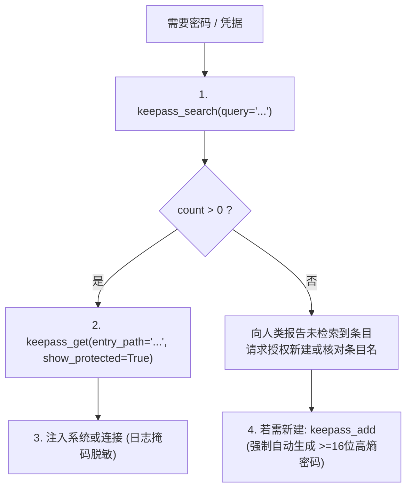

# 🔐 KeePass Vault 凭据中枢工程规范与操作指南

## 一、 核心底牌与物理第一性原理 (Hook Transparency)

1. **交代底牌律 (Hook Transparency)**：
   - 本插件已激活 `vault-guard` 物理生命神经反射；
   - 在执行任何写入、修改或删除（`keepass_add`, `keepass_edit`, `keepass_rm`）工具前，系统已通过底层 Hook 在同级目录自动创建 `Key.kdbx.YYYYMMDD_HHMMSS.bak` 物理安全备份；
   - 因此无需手动编写文件备份脚本，物理快照开箱即用。

2. **查库第一公理 (Lookup First Axiom)**：
   - 凡涉及 API Key、服务器 SSH 密码/密钥、数据库连接串、第三方凭据时，**绝对严禁向用户直接索要明文**；
   - 必须优先调用 `keepass_search` 搜索本地保险库。

3. **免明文与高密保护 (Zero-Plaintext Defense)**：
   - 读取凭据时，默认仅查看非敏感元数据（`title`, `username`, `url`）；
   - 仅在确需注入运行时连接时声明 `show_protected=True`，并在交互输出中对密码进行掩码脱敏（严禁在对话气泡中大段贴出明文）。

---

## 二、 标准调用工序状态机 (SOP Sequencing)

---

## 三、 标准工具调用矩阵 (9 Tools)

| 阶段 | 工具名称 | 核心用途与参数 |
| :--- | :--- | :--- |
| **状态巡检** | `keepass_status` | 检查本地数据库路径、连通性及主密钥配置状态 |
| **检索查询** | `keepass_search` | `query`: 模糊或精确搜索条目，获取 entry_path 清单 |
| **凭据读取** | `keepass_get` | `entry_path`: 读取条目属性；`show_protected=True` 提取密码 |
| **安全写入** | `keepass_add` | `entry_path`, `username`, `password`, `url`, `notes` (强制高熵) |
| **凭据更新** | `keepass_edit` | `entry_path`, 更新指定字段，自动写前备份 |
| **安全删除** | `keepass_rm` | `entry_path`, 物理删除条目，高危二次确认 |
| **分组遍历** | `keepass_list_tree` | `group="/"`, `recursive=True` 遍历分组结构 |
| **安全体检** | `keepass_analyze` | 审计弱密码、重复口令与密码过期状态 |
| **附件导出** | `keepass_export_attachment` | 导出 SSH 私钥、PEM 证书或配置文件至本地隔离目录 |

---

## 四、 异常诊断与自愈规程

1. **若 `can_unlock: False`**：
   - 检查 `~/.gemini/config/plugins/keepass-vault/config.json` 是否包含正确的 `kdbx_path` 与 `master_key`；
   - 或核对环境变量 `KPXC_MASTER_KEY` 是否有效；
2. **若 `keepassxc-cli 未安装`**：
   - 提示用户安装 KeePassXC 客户端并将其加入系统 PATH。
