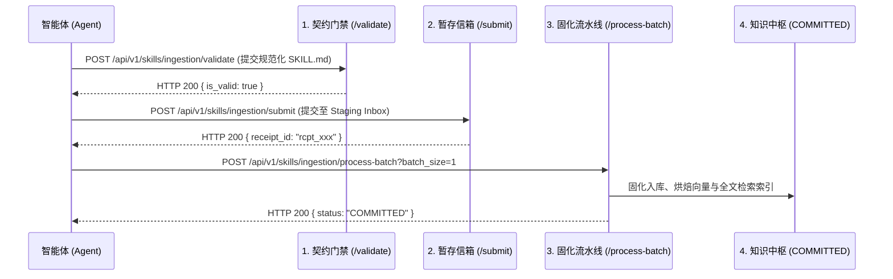

# Google Antigravity 原生插件开发与工程工法指南 (Antigravity Plugin Crafting v2.0)

本技能为在 **Google Antigravity Desktop (桌面端)** 与 **Google Antigravity IDE (编程端)** 生态下，打造 100% 官方合规、非暴力、非入侵式原生插件的**单一真相源 (SSOT) 标准工程工法**。

---

## 🧭 一、 查理·芒格逆向工程思考 — 17 大“必死之招”与防御铁律 (Munger Inversion)

> “反过来想，总是反过来想（Invert, always invert）。如果我知道自己会死在哪里，那我将永远不去那个地方。” —— 查理·芒格

若想让一个反重力插件必死无疑、引发宿主崩溃或被用户唾弃，最有效的做法如下。**看清这 17 大死穴，反向构建防御，插件必然稳如磐石**：

| 序号 | 致命毒药 (Anti-Pattern) | 崩坏现象与物理根因 | 芒格逆向防御铁律 (Engineering Invariant) |
| :--- | :--- | :--- | :--- |
| **死穴 1** | **暴力打猴子补丁 / 篡改二进制** | 篡改 IDE 的 `app.asar` 或底层二进制。官方一更新，补丁失效，全量白屏或无法启动。 | **100% 走官方 Customization 规范**：依托 `plugin.json`、`hooks.json`、`mcp_config.json`，做到零二进制侵入，前向兼容升级。 |
| **死穴 2** | **Windows 控制台抛 GBK 报错** | 脚本崩溃时抛出未捕获异常，输出 CP936 字节。IDE 底层 Go 进程塞入 Protobuf string 字段时触发 `invalid UTF-8` 校验，引发推流死循环，前端彻底白屏。 | **stderr 物理静音 + 字节流直写**：强制使用 `sys.stdout.buffer` 直写 UTF-8 字节，物理封闭 stderr，全流程捕获 `BaseException`，退出码恒为 0（Fail-Open）。 |
| **死穴 3** | **Hook 管道无脑 `read()` 阻塞** | 以为 IDE 会发送 EOF，调用 `sys.stdin.read()`。IDE 管道保持开启等待回传，导致父子进程双向死锁，3 秒后被超时强杀。 | **单行流式读取**：严禁 `read()`，必须使用 `sys.stdin.readline()` 单行解析，时延极限压至 10ms。 |
| **死穴 4** | **裸调全局 Python 导致冷启动击穿** | Windows 裸启动 Python 会扫描全部全局 site-packages，耗时高达 3.3 秒，刚好击穿 IDE 3.0s 超时门禁。 | **纯标准库隔离三剑客 (`-E -s -S`)**：在 Hook 命令中强制配置 `python.exe -E -s -S <script>`，将冷启动耗时骤降至 40ms（快 80 倍）。 |
| **死穴 5** | **配置孤岛：仅配私有 MCP 导致主面板失明** | 仅在 `plugins/<name>/mcp_config.json` 中配置，桌面端主界面「MCP 服务器」列表与「Manage MCP servers」无法感知，沦为孤岛。 | **双轨注册机制 (Dual-Track MCP)**：既保留插件私有 `mcp_config.json`（内聚规范），安装器同时优雅联动全局 `~/.gemini/config/mcp_config.json`，实现双向点亮。 |
| **死穴 6** | **写死单端脑区路径，跨端即瘫痪** | 桌面端脑区路径为 `antigravity/`，IDE 端为 `antigravity-ide/`。硬编码任一路径会导致在另一端找不到会话与状态文件。 | **双端路径自适应嗅探**：看门狗脚本根据 payload 中的 `artifactDirectoryPath` 动态提取宿主类型，实现桌面端与 IDE 端无感切换。 |
| **死穴 7** | **机械步数一刀切，打断长线交付** | 写死单轮 18 步硬上限，在端到端交付、TDD 测试与收尾提交时连环弹窗误杀，破坏开发者心流。 | **自适应弹性增量租约**：36 步健康态 / 15 步警戒态 / 人类放行 +15 步租约 / 收尾文档白名单 / 轮次清零。 |
| **死穴 8** | **端侧就地魔改与多机人工穿刺** | 跑到 ~/.gemini/config/plugins/ 里打临时补丁，或逐台 SSH 到远程机器手动改文件。导致多机器版本全部分裂断层，沦为不可控的“雪花环境”。 | **唯一公共源修改 + 单向拉取部署 (Pull-Only)**：严禁端侧就地改动。所有修复 100% 在统一源码中枢进行、严格 Bump 版本并提交 Git；客户端只通过标准一键拉取安装命令部署。 |
| **死穴 9** | **版本幽灵与硬编码断层** | 修改了工具或 Hook 但未递增 plugin.json 版本，或在 setup.py 中写死硬编码常数。导致 IDE 缓存跳过更新、版本覆盖报错或多节点状态漂移。 | **单一真相源 (SSOT) 动态直连 + 凡更必 Bump**：setup.py 动态解析 plugin.json 提取版本；母本、部署端、宿主 config.json 注册表与探针四位一体 100% 同频。 |
| **死穴 10** | **半拉子安装与拓扑盲盒** | 仅拷贝文件到 plugins 目录导致 IDE 未激活注册；本地 2080 环境盲目使用公网域名造成代理拦截与秒级延迟。 | **自适应拓扑探测 + 宿主注册表写入**：本地强制锁死 127.0.0.1:1933 环回与管理员凭据；setup.py 自动幂等写入 ~/.gemini/config/config.json 的 plugins 字段。 |
| **死穴 11** | **兼容别名双写导致 MCP 双胞胎与工具虚胖** | 为兼容旧配置在私有或全局 `mcp_config.json` 中双写多个 alias（如 `openviking` 与 `openviking-memory`）。IDE 忠实按 Key 实例化，导致界面产生双胞胎条目与调用冲突。 | **单一真相源命名 + 安装向导主动 pop 清洗**：Plugin ID、目录名与 MCP Server Key 必须 100% 同名对齐；向导脚本 `setup.py` 注册新服务时强制执行 `servers.pop("openviking", None)` 清洗残留。 |
| **死穴 12** | **死徽章与端侧静态副本脱节** | 在 `README.md` 中手写死版本徽章；Windows 端侧为静态复制目录，母本更新后端侧未同步，导致反重力概览页面版本永远落后。 | **文档版本级联注入 + 自动全量同频流水线**：以母本 `plugin.json` 为唯一源，流水线正则自动重写 `README.md` 徽章与文案；发版与同步命令原生绑定端侧部署。 |
| **死穴 13** | **Hook 内部无超时同步网络请求** | 在 Hook 或看门狗中调用本地/远程网络 API，未显式配置短超时参数。遇到网络抖动或服务端重启，Hook 挂起假死导致 IDE 交互全盘冻结。 | **零裸调网络与毫秒级短超时门禁 (Sub-Second Timeout)**：Hook 网络请求强制 `timeout <= 1.5s`（本地探针 `<= 300ms`）；必须用 `BaseException` 兜底，超时或异常立即 Fail-Open 瞬时放行。 |
| **死穴 14** | **Windows 独占文件锁并发踩踏 (File Lock Race)** | 多 Agent 或多工具并发运行时，Hook 脚本若同时向同一个状态文件执行 `open(..., "w")`，Windows 强制文件锁立即触发 `[WinError 32]` 崩溃。 | **原子写替换与文件锁退避 (Atomic Write)**：严禁原地截断覆写。必须写入带 PID 的临时文件后执行原子替换（`os.replace`）；或使用指数退避捕获锁冲突，防止状态文件被踩成 0 字节损坏。 |
| **死穴 15** | **PreInvocation 上下文投毒与 Token 膨胀** | 贪大求全将全量巨石文档或庞大记忆每轮通过 `ephemeralMessage` 塞入上下文，5 轮会话耗尽 200k 窗口，注意力涣散且每轮空耗数十万 Token。 | **注脑 Token 物理硬预算 (≤ 300 Token)**：动态注入必须遵循“阅后即焚、脱水高密”。单次注入硬性下限不超过 3 行关键事实，总字符 ≤ 500 字节，严禁倾倒巨石文档。 |
| **死穴 16** | **卸载半拉子留下的“僵尸钩子” (Zombie Hooks)** | 仅删除插件目录但未清理 `config.json` 注册表与 `hooks.json`。IDE 随后每次调用工具均因找不到守卫脚本抛出 `File Not Found`，工具链全量瘫痪。 | **生命周期对称与反向清理契约 (Symmetric Lifecycle)**：安装与卸载必须成对闭环。`setup.py` 必须提供完全对等的 `uninstall` 命令，负责注销 `config.json`、安全移除 MCP 联动并清理残留。 |
| **死穴 17** | **工作区随地拉屎与凭据污染 (Workspace Pollution)** | 插件运行时在用户项目工作区根目录下创建 `.cache`、`state.json` 或 `debug.log`，污染用户 Git 状态，甚至意外将敏感 Key 推至公开仓库。 | **私有状态隔离飞地 (State Enclave)**：插件运行时数据绝对严禁写入用户工作区！所有状态、缓存与日志只能且必须保存在插件私有目录（`~/.gemini/config/plugins/<name>/data/`）或系统 `$TEMP` 中。 |

---

## 🏛️ 二、 Google 官方标准插件拓扑结构 (Official Plugin Topology)

根据 Google 官方规范（`https://antigravity.google/schemas/v1/plugin.json`），标准构件拓扑如下：

```text
~/.gemini/config/plugins/<plugin-name>/   (或工作区级 .agents/plugins/<plugin-name>/)
├── plugin.json         # [必需] 官方标准清单声明 (唯一版本真相源 SSOT)
├── mcp_config.json     # [可选] 插件私有挂载的 MCP 服务器声明 (Stdio / SSE)
├── hooks.json          # [可选] 官方 5 大原生生命周期钩子反射配置
├── rules/              # [可选] 插件激活后自动注入的规则契约 (*.md，无需 Frontmatter)
├── skills/             # [可选] 插件暴露的领域认知导轨 (<skill-name>/SKILL.md)
├── scripts/            # [建议] 核心看门狗、守卫或辅助执行脚本
├── setup.py            # [必需] 跨平台一键开箱安装与双轨自举向导
└── README.md           # [必需] 插件详情页「概览」Tab 渲染文档 (版本由脚本级联注入)
```

---

## 📑 三、 核心文件配置规范与官方契约

### 1. `plugin.json`：大厂官方级清单规范
切忌只写 `name` 和 `description`，必须补齐官方完整要素：
```json
{
  "$schema": "https://antigravity.google/schemas/v1/plugin.json",
  "name": "agent-circuit-breaker",
  "displayName": "智能体自适应断路器",
  "version": "1.3.3",
  "description": "专为 Google 反重力打造的物理级自适应断路器，具备 36 步健康预算、Fail-Open 故障自愈与 force_ask 零误杀双重防护。",
  "logo": "https://vk.tide.red/studio/ov-logo.png",
  "suggestedPrompts": [
    "检查当前断路器健康状态与步数预算",
    "重置当前会话的断路器状态与报错计数",
    "查看断路器自省停手规则与三行事实交接契约"
  ],
  "author": { "name": "OpenViking Eco & Antigravity Squad" },
  "keywords": ["antigravity", "circuit-breaker", "guardrails", "fail-open"],
  "repository": "https://vk.tide.red",
  "license": "Apache-2.0"
}
```

### 2. `hooks.json`：官方合法 5 大生命周期钩子
官方**仅支持**以下 5 种事件，切勿编写非标事件名（如 SessionStart）：
| 官方事件名 | 触发时机 | 典型入参 | 典型出参能力 |
| :--- | :--- | :--- | :--- |
| **`PreToolUse`** | 工具执行前 | `toolCall`, `stepIdx` | `decision`: `"allow"` / `"deny"` / `"ask"` / `"force_ask"`, `reason`, `overwrite` |
| **`PostToolUse`** | 工具执行后 | `toolCall`, `error` | `{}` (用于监听记账，失败即时累加计数) |
| **`PreInvocation`** | 模型推理前 | `invocationNum` | `injectSteps`: `[{"ephemeralMessage": "..."}]` (临时温和预警注脑) |
| **`PostInvocation`**| 模型推理后 | `initialNumSteps` | `terminationBehavior`: `"force_continue"` / `"terminate"` |
| **`Stop`** | 循环准备终止时 | `terminationReason` | `decision`: `"continue"` (阻止终止并继续自愈) |

**标准 `hooks.json` 模板 (纯标准库 -E -s -S + -X utf8 隔离)**：
```json
{
  "my-guard": {
    "PreToolUse": [{
      "matcher": "*",
      "hooks": [{
        "type": "command",
        "command": "python.exe -X utf8 -E -s -S C:/path/to/guard.py pre-tool",
        "timeout": 4
      }]
    }]
  }
}
```

---

## 🔄 四、 双端自适应适配规范 (Desktop vs IDE)

编写守护脚本时，通过 payload 自适应判定当前宿主环境：
```python
def detect_antigravity_runtime(payload: dict) -> str:
    art_path = payload.get("artifactDirectoryPath", "")
    trans_path = payload.get("transcriptPath", "")
    full_str = f"{art_path}|{trans_path}".lower()
    if "antigravity-ide" in full_str:
        return "ide"
    elif "antigravity-cli" in full_str:
        return "cli"
    return "desktop"
```
- **IDE 端特权**：单文件 500 行红线拦截、写操作报错震荡 `force_ask`、收尾文件（`REFACTORING_PLAN.md`）免受步数限制；
- **Desktop 端特权**：全局对话持久化、体外大脑会话自动结晶与归档。

---

## ⚡ 五、 单一真相源 (SSOT) 全自动级联迭代 SOP

为彻底根治“一个地方一个地方核对版本号”的痛点，全系统采用 **Version Cascade 自动级联体系**：

```
母本 plugin.json (唯一输入源)
       │
       ▼ 自动化级联 (Zero Manual Touch)
┌────────────────────────────────────────────────────────┐
│ 1. 自动重写 README.md 徽章链接与文本 (badge/version-X.Y.Z)│
│ 2. 自动更新 setup.py 内部版本说明                       │
│ 3. 自动自举安装至 ~/.gemini/config/plugins/<name>      │
│ 4. 自动写入 ~/.gemini/config/config.json 宿主注册表    │
│ 5. 自动触发 pack_all_plugins.py 生成不可变 .tgz 分发包 │
│ 6. 自动输出四方版本对齐审计大盘 (7/7 PASS 验真)        │
└────────────────────────────────────────────────────────┘
```

### 极速操作命令：
1. **一行命令全自动升级（0 人工介入）**：
   ```powershell
   python scripts/sync_all_plugins.py --bump <plugin-name> <new-version>
   ```
2. **日常同步自动带出（零感知同频）**：
   日常执行 `python scripts/sync_to_wsl.py`，第 0 步自动完成全量插件文档级联、端侧部署与打包。
3. **一键版本审计大盘验真**：
   ```powershell
   python scripts/sync_all_plugins.py --verify-only
   ```

---

## 🏛️ 六、 OpenViking 官方技能中心标准四阶入库流水线

所有新技能与技能升级一律严禁手搓 `cp/mv`，强制遵循官方准入流水线：



### 准入脚本标准模板：
```python
import json, urllib.request

BASE = "http://127.0.0.1:1933/api/v1/skills/ingestion"
HEADERS = {"Authorization": "Bearer <KEY>", "Content-Type": "application/json"}

# 1. 门禁校验
urllib.request.urlopen(urllib.request.Request(f"{BASE}/validate", data=v_payload, headers=HEADERS))
# 2. 暂存提交
urllib.request.urlopen(urllib.request.Request(f"{BASE}/submit", data=s_payload, headers=HEADERS))
# 3. 批处理固化
urllib.request.urlopen(urllib.request.Request(f"{BASE}/process-batch?batch_size=1", data=b"", headers=HEADERS))
```
状态机变更为 `COMMITTED` 后，全集群 Agent 自然语言即可 100% 自动找回！
