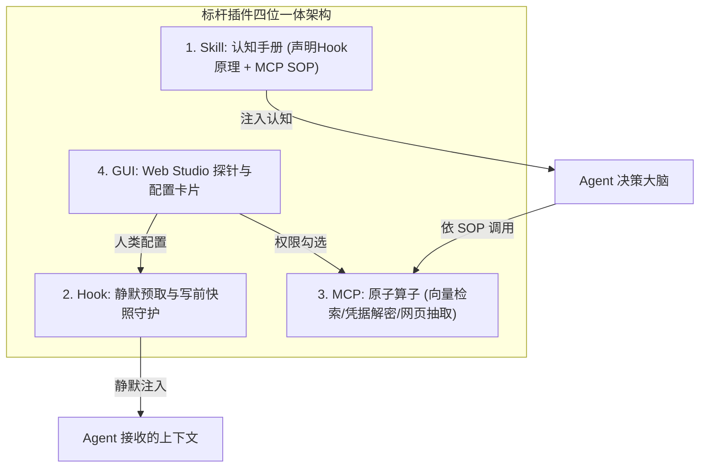
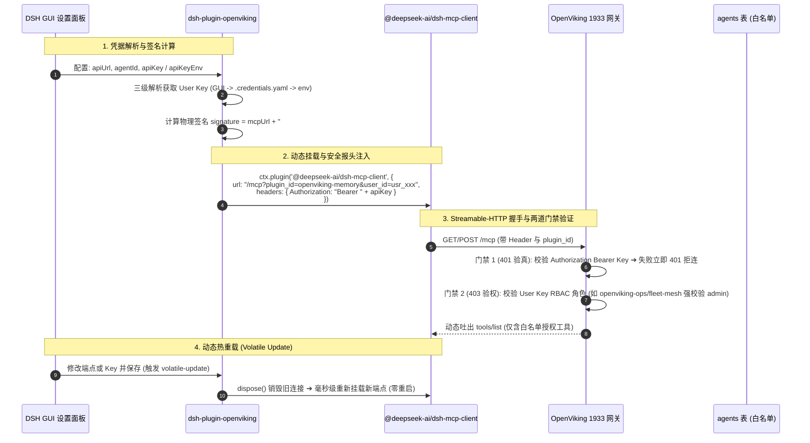

# 🏛️ OpenViking 插件中心与 Agent 生态工程研发与运维中枢 (Plugin Master Spec)

> **"From Client-Side Bloatware to Server-Centric Dynamic Capability Projection."**  
> 本技能是 OpenViking 插件生态、三大官方标杆插件 (KeePass凭据 / VK记忆 / 联网搜索)、插件制作与全生命周期运维的**统一物理架构与规范中枢 (SSOT)**。全系统异构智能体（DeepSeek Harness、Claude Desktop、Cursor、Antigravity、卫星集群）统一基于本规范互联同频。

---

## 📌 一、 核心物理第一性原理：服务端本体 + 客户端轻量桥梁

在现代体外大脑（Exocortex）架构中，必须坚决切除“给 Agent 赋予能力就必须把代码打包安装到客户端”的旧心智模型：

```text
┌────────────────────────────────────────────────────────────────────────┐
│                        真正的物理世界架构运作图                        │
├────────────────────────────────────────────────────────────────────────┤
│                                                                        │
│   【Wiki 服务器 / OpenViking 中枢 (插件本体 100% 在此运行)】           │
│   ┌──────────────────────────────────────────────────────────────┐     │
│   │ • 插件中心 (平台插件 & 用户插件)                             │     │
│   │   - 记忆检索/图谱/做梦/AST (openviking-memory, 47 项工具)     │     │
│   │   - KeePass 凭据库 (.kdbx 加密驱动, 10 项工具)               │     │
│   │   - 联网采集 (SearXNG + Crawl4AI, 2 项工具)                  │     │
│   │ • Agent 中心 (租户级权限路由器)                              │     │
│   │   - 记录: 每个 Agent 启用了哪些插件、勾选了哪些工具白名单    │     │
│   │   - 同步下发: 配套专属 Skill SOP 与激活对应 Hook 守护        │     │
│   └────────────────────────────────────────────────────────────┘     │
│                                  ▲                                     │
│                                  │ 单一通用桥梁 (极轻量 JSON/RPC 管道) │
│                                  ▼                                     │
│   【不同节点的各类客户端 (3070节点 / 2080Ti / Mac / DSH / Claude)】   │
│   ┌──────────────────────────────────────────────────────────────┐     │
│   │ 客户端电脑里【根本没有插件的真实代码】！                    │     │
│   │ 它装的所谓“插件”，其实只是一座【通信桥梁 (Proxy Stub)】：    │     │
│   │ 1. 握手问服务器：“我是 Agent A，我能用什么工具与配套技能？”  │     │
│   │ 2. 模型调工具时：“把这串参数发给服务器执行，拿回结果给模型” │     │
│   └────────────────────────────────────────────────────────────┘     │
│                                                                        │
└────────────────────────────────────────────────────────────────────────┘
```

1. **插件本体永远在服务器**：
   - 数据库读写、向量计算、AES-256 凭据解密、爬虫浏览器等重型逻辑与敏感数据，100% 运行于 OpenViking 服务端；
   - 客户端（DSH / Claude / Cursor）永远不需要安装复杂的 Python/Docker 环境。
2. **客户端永远只安装【单个不可变通用桥梁】**：
   - 客户端只需要安装一条标准化、无状态的轻量管道（如标杆 `dsh-plugin-openviking`）；
   - 连接端点绑定身份：`https://vk.tide.red/mcp?plugin_id=openviking-memory&user_id=usr_xxx`。
3. **动态能力投影 (Dynamic Capability Projection)**：
   - 当客户端握手发起 `tools/list` 时，服务端 FastMCP 网关根据该 Agent 的授权白名单，**动态下发工具定义**；
   - 用户在 Web Studio 勾选或禁用工具，**客户端零重新打包、零重新安装、秒级热生效**！

---

## 🧩 二、 插件四位一体架构与深度咬合铁律 (Quad-Model & Interlock SSOT) ⭐⭐⭐⭐⭐

> **核心哲学拷问**：  
> “光有 MCP，Agent 面对几十个凶器不知道怎么用，必然盲目调用、引发幻觉；  
> 光有 Hook，底层虽然自动处理了，但 Agent 不理解 Hook 原理，下意识又去调 MCP，造成‘左右互搏与重复浪费’；  
> 光有技能没有工具只是死文档；光有后台没有 GUI 人类两眼一抹黑。  
> **因此：Skill + Hook + MCP + GUI 四位一体紧密咬合，才是一个完整的生产级插件！**”

### 1. 插件四维物理职责矩阵

| 层次 (Layer) | 核心载体 | 生物学隐喻 | 承担的物理职责与核心契约 |
| :--- | :--- | :--- | :--- |
| **🧠 1. Skill (认知层)** | `SKILL.md` (SOP 指南) | **大脑 / 认知导轨** | **教 Agent “何时用、按何顺序用、绝不可怎么用”**。<br>在开头**必须交代 Hook 底牌**，明示 MCP 规范 SOP 与降级逻辑。 |
| **⚡ 2. Hook (拦截层)** | 生命周期钩子脚本 | **自主神经 / 条件反射** | **机器级、零 Token、确定性的自动化静默守护**。<br>在调用前预热注入上下文，调用后提纯教训，拦截阻断越权投毒。 |
| **🦾 3. MCP (工具层)** | FastMCP 协议算子 | **四肢 / 物理执行手** | **承担真实业务重活的原子接口**。<br>读写 SQLite、向量相似度检索、AES 解密、无头浏览器爬虫抽取。 |
| **👁️ 4. GUI (交互层)** | Settings Schema / Web Studio | **五官 / 驾驶舱视窗** | **人机交互、参数配置与观测视网膜**。<br>人类填写服务 URL、API Key、勾选开启哪些工具，查看健康探针。 |

### 2. 深度物理咬合与防冲突三大铁律 (The Anti-Conflict Laws)

1. **【交代底牌律 (Hook Transparency)】**：
   - 配套 Skill 开篇第一条必须向 Agent 明示当前 Hook 的静默行为：
   - *“例：本插件已激活 `ov_pre_invocation` 神经反射。在你收到 Prompt 前，系统已自动将最相关的核心记忆注入在上下文顶部。因此你**严禁开局无脑重复调用 find 盲搜**，避免浪费双倍 Token 与产生时延。”*
2. **【精密工序 SOP 律 (SOP Sequencing)】**：
   - 坚决杜绝让 Agent 自由瞎猜。Skill 必须给出确定性的调用状态机（如：“先查 outline 确认接缝 ➔ 若缺细节再 grep 精确定位 ➔ 修改前先调用 commit 快照 ➔ 严禁直接全量覆写”）。
3. **【权限隔离与优雅降级律 (Graceful Degradation)】**：
   - Skill 必须教会 Agent 理解 403 权限响应：当某 MCP 工具返回未授权时，属于租户白名单主动剥离，Agent 必须优雅回退，绝不陷入盲目重试死循环。

### 3. 云端权限物理剪枝与绝对真实探针铁律 (Zero-Leakage & Real Probing SSOT) ⭐⭐⭐⭐⭐

1. **【云端权限物理剪枝律 (Least-Privilege & Zero-Leakage)】**：
   - 云端 Web Studio 是唯一权限中枢；
   - 服务端在下发能力清单 (`/api/v1/system/client-capabilities`) 时，**必须在下发前完成物理剪枝过滤**；
   - 未被授权的高危或特权工具（如中枢运维工具 `write`、`edit`、`forget` 等），**绝对禁止出现在下发给客户端的 JSON Schema 中**；
   - 客户端仅能看到并操作已授权范围内的工具，彻底消灭客户端越权感知与越权勾选入口。
2. **【100% 绝对数据真实性探针律 (Absolute Data Integrity Probing)】**：
   - 连通性体检探针**绝对禁止任何硬编码假延迟与模拟 Mock 数据**；
   - 每一项探针必须真实发起底层调用并测量物理时间（如 SearXNG 本地网络探测、KeePass Argon2 KDF 安全解密物理开销约 1,000ms）；
   - 权限未授予时，探针必须真实返回 `403 Forbidden` 并在前端标红拦截，确保状态 100% 真实可信。
3. **【大模型 Tool-Calling 多插件排他律 (Tool Competition Handover)】**：
   - 异构客户端（如 DSH）部署时，**必须物理停用/卸载失效或欠费的官方同类扩展**；
   - 消除多插件概率性随机调用的冲突，杜绝首跳撞墙 `provider not registered`，保障自研矩阵 100% 独占流畅命中。

---

## 🏛️ 三、 三大官方标杆插件全息盘点 (The Big Three Quad Matrix)

全系统三大官方标杆插件按“四位一体”严格对照盘点如下：



| 标杆插件 ID | 1. Skill (认知脑) | 2. Hook (神经反射) | 3. MCP (执行手) | 4. GUI (驾驶舱) |
| :--- | :--- | :--- | :--- | :--- |
| **`dsh-plugin-openviking`**<br>(官方标杆通用 RPC 桥接插件 v1.5.0)<br>产物: `dsh-plugin-openviking-1.5.0.tgz` | **0 项随包规约**<br>(体外大脑 SSOT 统一管理)<br>• 插件纯为通用轻量 RPC 适配桥梁<br>• 不硬编码静态死技能<br>• 随 Agent 身份动态注入认知 | **3 项物理反射**<br>• `ov_pre_invocation`: 提问前静默召回核心记忆注入 Prompt 顶部<br>• `ov_lesson_crystallizer`: 答后离线提纯教训入库<br>• `ov_sandbox_guard`: 运行态越权与高危拦截 | **50 项 FastMCP 全量物理工具**：<br>• 34 项业务使用者工具 (知识读写/代码分析/AST测试/AIFP工单)<br>• 16 项中枢运维特权工具 (代码写改/死信自愈/流水线/硬件探针) | • DSH 客户端原生 GUI 配置表单<br>• `https://vk.tide.red/studio/dsh-plugin-openviking-1.5.0.tgz` 一键复制<br>• 支持机国内网 (1933) 与跨网公网双端点自适应切换 |
| **`keepass-vault`**<br>(KeePass 凭据中枢扩展) | **`keepass-vault`**<br>• 查库第一公理，严禁索要明文<br>• $\ge 20$ 位高熵密码生成契约<br>• 批量建号格式化落盘 SOP | **`vault_guard_hook`**<br>• **写前自动防抖物理快照** (`*.bak`)<br>• 敏感外呼自动注入动态凭据<br>• 外部未知网页物理熔断阻断 | **10 项凭据工具**：<br>• `keepass_get` (获取凭据)<br>• `keepass_search` (模糊查找)<br>• `keepass_add` (高熵新增)<br>• `keepass_analyze` (健康体检) | • `.kdbx` 保险箱路径配置<br>• 解锁状态安全指示灯<br>• 一键应急熔断开关<br>• 快照与备份日志视窗 |
| **`network-search`**<br>(联网搜索与采集扩展) | **`network-search-ops`**<br>• 搜索降级链 (SearXNG ➔ 爬取)<br>• 防爬死锁与超长截断规范<br>• 事实脱水与广告过滤 SOP | **`search_guard_hook`**<br>• 自动判定时效性意图并预热<br>• **外部网页污点标记 (Tainted)**<br>• 截断超大 Payload ($\le 8\text{KB}$) | **2 项采集工具**：<br>• `searxng_search` (免翻搜索)<br>• `crawl4ai_extract` (正文清洗) | • SearXNG 8888 容器健康瓦片<br>• Crawl4AI 抽取模式切换<br>• 搜索重试与超时阈值配置 |

---

## 🔒 三、 零信任单轨鉴权与空间用户双轴隔离铁律 (Zero-Trust & Dual-Auth SSOT) ⭐⭐⭐⭐⭐

> **芒格逆向审讯与第一性原理**：  
> “严禁搞‘本地内网免密码、公网远程要密码’的双轨割裂！本地免密不仅是伪安全漏洞，更是诱发‘本地测得绿、远端摔死崩’的罪魁祸首！全系统必须单轨零信任统一要求通信令牌；  
> 严禁搞所谓的‘免密只读访客通道 (Guest Mode)’！体外大脑是绝对私有的个人数字灵魂与机密资产，绝非公共维基，任何无 Key 请求一律物理阻断拒止；  
> 鉴权必须是空间（Tenant）+ 用户（Agent）双轴强绑定，通过 256-bit 高熵密钥实现数学级防碰撞，绝对杜绝跨空间同名用户串号越权！”

### 1. 零信任单轨鉴权公理 (Never Trust, Always Verify)
- **环境零特例**：无论主力机本地回路 (`127.0.0.1:1933`)、局域网 (`192.168.x.x`) 还是跨网公网域名 (`https://vk.tide.red`)，服务端统一执行单轨鉴权：**必须携带合法 Bearer Token**。
- **本地严禁免密特例**：本地开发与单测开局第一秒即必须携带合法凭据，不带立即 Fail-Fast，杜绝“本地正常、远端 401”的假象。

### 2. 体外大脑绝对私有封闭堡垒公理 (Private Exocortex SSOT)
- **100% 封闭私有**：体外大脑承载 ADR 架构底牌、KeePass 密码树、服务器拓扑、量化风控规则与踩坑教训，严禁向互联网提供任何未授权访问通道。
- **封杀 Guest 访客模式**：严禁搞任何“免密只读降级”。无 Key 物理拒止（0 响应、0 泄露、401 物理切断），新工兵与节点必须经管理员正式认主授权。

### 3. 空间 + 用户双轴强绑定防碰撞与防串号物理契约 (Tenant-User Dual Auth)
- **数学级防穷举碰撞**：User Key 必须由密码学安全随机数生成器 (CSPRNG) 生成 $\ge 256\text{-bit}$ 高熵令牌（搜索空间 $2^{256}$），物理抗穷举。
- **复合身份物理沙箱**：Key 底层强绑定 `(Account_ID, User_ID)` 唯一坐标。所有存储与向量检索严格沙箱化于 `viking://<Account>/<User>/...`；即使 A 空间与 B 空间均有同名 `worker`，底层物理分段隔离，绝不可能串号。
- **客户端双轴声明与服务端交叉阻断**：客户端请求 Header 声明 `X-Account-ID` 与 `X-Agent-ID`，服务端做双轴交叉强校验，不一致直接 `403 Forbidden` 阻断 IDOR 越权。

---

## 🛠️ 四、 插件制作标准技能指南 (Quad-Model Authoring SOP)

> **未来开发任何新插件的最高铁律**：  
> 新插件立项，必须自问四层：**MCP 是什么？Hook 怎么保护？Skill 怎么教 Agent？GUI 怎么给人类看？**  
> 坚决禁止只暴露几个裸 MCP 工具就草草宣布“开发完成”，四位一体齐备才叫插件！且 100% 仅在服务端开发，客户端零代码！

### 步骤 1：在服务端实现物理算子 (Server-Side MCP Tools)
在 OpenViking 服务端通过 FastMCP 暴露强类型、输入输出受控的原子工具算子：
```python
from mcp.server.fastmcp import FastMCP
from pydantic import BaseModel, Field

class ArticleExtractRequest(BaseModel):
    url: str = Field(..., description="目标网页或文章 URL")
    max_length: int = Field(8000, description="最大截断字符数")

@mcp.tool(name="wechat_extract_article")
def wechat_extract_article(req: ArticleExtractRequest) -> dict:
    """提取微信公众号文章正文并清洗为纯净 Markdown"""
    return {"status": "ok", "content": clean_content}
```

### 步骤 2：编写自动化切面与神经反射 (Defensive Hook)
实现该插件生命周期拦截器（如在提取前做 URL 白名单校验，提取后自动打上污点隔离标）：
```python
# hooks/wechat_guard.py
def before_extract(url: str):
    if not is_valid_article(url):
        raise ValueError("Invalid target")
```

### 步骤 3：编写配套专属认知手册 (Skill SOP) ⭐
在 `skills/wechat-extract/SKILL.md` 中编写操作手册，**第一条必须向 Agent 交代 Hook 原理与工具时机**：
```markdown
# 微信文章抓取认知导轨
1. 【交代底牌】：系统已激活 wechat_guard，外部链接已自动预校验。
2. 【调用时机】：仅在用户显式给出文章 URL 时调用；长文自动脱水，禁止反复抓取相同文章。
3. 【降级策略】：若返回 403 代表租户未授权，直接建议用户贴文本，严禁盲目重试。
```

### 步骤 4：定义 GUI Settings Schema 并在插件中心登记 (Plugin Registry)
在 `openviking/service/plugin_registry.py` 中全量登记四位一体元数据：
```python
PLUGIN_REGISTRY.register({
    "plugin_id": "wechat-reader",
    "name": "微信公众号文章解析器",
    "version": "1.0.0",
    "category": "platform",
    "description": "免登录抓取微信长文并脱水过滤广告",
    "skill_id": "wechat-extract",        # 配套认知指南 (Skill)
    "hook_ids": ["wechat_guard"],         # 配套自主神经 (Hook)
    "tools": [                            # 配套执行手 (MCP)
        {"name": "wechat_extract_article", "description": "提取文章正文并清洗为 Markdown"}
    ],
    "gui_schema": {                       # 配套驾驶舱 (GUI)
        "token": {"type": "string", "label": "抓取凭证 (可选)"}
    }
})
```

---

## ⚙️ 五、 插件运维标准技能指南 (Plugin Ops SOP)

### 1. 服务端健康度探活运维
* 插件中心必须具备物理探针：定期对 KeePass（是否锁闭）、SearXNG（8888 是否通畅）、Memory（SQLite/向量库）发起探活；
* 异常时在前端座舱优雅展示 `--` 或状态胶囊，坚决杜绝级联雪崩。

### 2. 客户端通用桥梁分发与严格 SemVer 运维 ⭐⭐⭐⭐⭐
客户端通用桥梁插件（如 `dsh-plugin-openviking`）本身的维护，严格遵循以下铁律：
* **Pack-Commit Atomic Lock**：发布前必须 Git Commit 物理落盘，严禁未提交直接打包；
* **Standalone Schema Bundle**：单文件 `schema.js` (34KB) 必须内联内嵌，确保 GUI SettingsForm 100% 渲染；
* **严格 SemVer X.Y.Z 物理契约**：
  * **X (MAJOR)**：仅在不兼容协议断代或架构级重写时升级；
  * **Y (MINOR)**：仅在新增了向后兼容的**实质性业务新特性/新视图**时升级；
  * **Z (PATCH)**：**日常排障、Bug修复、防御补丁、Volatile标注、生命周期释放 100% 只能且必须升级 Patch (如 1.5.0 ➔ 1.5.1)**！严禁滥用 Minor！
* **分发端点公网单一真实源**：统一固定为不可变端点 `https://vk.tide.red/studio/dsh-plugin-openviking-${VERSION}.tgz`。

---

## 🛡️ 六、 芒格逆向审讯：五道免死金牌防御矩阵 (Munger Inversion SSOT)

| 极端死因倒推 (Failure Mode) | 真实爆发场景与灾难 | 物理免死金牌 (Defensive Gatekeeper) |
| :--- | :--- | :--- |
| **1. 混淆代理人投毒**<br>(Confused Deputy) | 搜索插件抓到黑客网页，网页内嵌 Prompt 诱骗 Agent 调用 KeePass 偷密码回传公网。 | **【污点标记与单向熔断门禁】**：会话一旦吸纳外部未经清洗网页，立即标记 `tainted`，该会话周期内物理阻断任何凭据类工具！并在 Agent 中心对爬虫类 Agent 物理剥夺凭据权限！ |
| **2. 依赖断网与版本撕裂**<br>(Network Drift) | 3070 节点或机房内网无外网，npm 官方源超时卡死；或网关升级后客户端大面积 500 暴毙。 | **【自建源静态托管 + 协议自愈协商】**：以 OpenViking `/studio/*.tgz` 为 SSOT 分发源；网关端点必须支持老版本自适应向下兼容。 |
| **3. 远程凭据越权脱库**<br>(Remote Breach) | 远程 Agent 连上中枢后，顺藤摸瓜将宿主机上的私人总账密码库全部脱库。 | **【Local-First 就地自治 + 工具白名单】**：插件在谁的机器上就只读谁的本地数据库；严禁跨机偷库，未授权 Agent 连 `keepass_get` 的定义都看不到。 |
| **4. Hook 备份风暴与延迟雪崩**<br>(Latency Stacking) | 批量注册 50 个账号连续触发 50 次物理拷贝；每次调用都同步跑大模型，延迟飙至 10 秒。 | **【快照防抖合并 + 异步非阻塞切面】**：10 秒内的连续写入合并为单次快照；日志审计与经验提纯全量扔进异步后台协程，读操作 0.01ms 瞬时放行。 |
| **5. 人机锁屏心智脱节**<br>(Lockscreen Illusion) | 人类在 Windows 上锁定了 KeePass，后台 Linux 的 `vault.env` 却依然在无阻断解密读写。 | **【内存短暂令牌 (Ephemeral Token)】**：提供一键应急熔断开关 (Kill-Switch)，检测锁屏心跳立即清空内存解密缓存。 |

---

## 🔐 七、 异构客户端认证鉴权与 RPC 桥梁全链路时序契约 (Auth & RPC Bridge SSOT) ⭐⭐⭐⭐⭐

以标杆 **DeepSeek Harness (DSH)** 客户端为例，客户端与 OpenViking 1933 网关之间的认证鉴权与动态流转机制严格遵循以下物理契约：



### 1. 核心第一性原理：认证与授权双轨分离 (Authentication vs Authorization)
* **User Key (用户凭据 / API Key) 负责【身份验真 (Authentication)】**：
  * 证明“你是哪个合法的租户/人类用户”；
  * 如果密钥错误或缺失，服务端第 1 道门禁直接拦截，返回 `HTTP 401 Unauthorized`。
* **User Key 与插件包负责【权限范围与能力投影 (Authorization)】**：
  * 工具能力与插件包 1:1 强绑定（Memory 34 tools, Ops 17 tools, Fleet 2 tools）；
  * 网关根据 User Key 的角色 (admin vs user) 执行 RBAC 门禁，非 admin 访问 Ops/Fleet 立即 403 Forbidden 物理拦截。

### 2. DSH 客户端三级凭据自动探测链 (Triple Resolution Chain)
在 `dsh-plugin-openviking` 的 `index.js` 中，User Key 严格按以下优先级无感读取：
1. **优先 1：GUI SettingsForm 直接配置**：
   * `Config.apiKey`（定义为 `v(Schema.string().role('secret').default(''))`），在 DSH 设置面板带密码圆点遮罩直接输入，随配置落盘；
2. **优先 2：DSH 官方凭据保险库 (`.credentials.yaml`)**：
   * 遵循 DSH 官方最佳实践，通过 `Config.apiKeyEnv`（默认 `OPENVIKING_API_KEY`）键名，自动扫描并解析 `~/.dsh/.credentials.yaml` 中的明文密钥；
3. **优先 3：宿主机操作系统环境变量**：
   * 兜底读取 `process.env[apiKeyEnv]`。

### 3. RPC 桥梁安全传递三契约
1. **路由与角色走 Query 参数**：
   * `url: ${api}/mcp?plugin_id=${pluginId}&user_id=${encodeURIComponent(userId)}`
   * 告诉网关本次连接代表谁、需要投影哪份工具白名单；
2. **敏感凭据绝不走 URL，严格走 HTTP Header**：
   * `headers: { 'Authorization': 'Bearer ' + key, 'X-OpenViking-Actor-Peer': peer }`
   * 严禁将 API Key 拼进 URL 中，彻底避免被反向代理（如 Nginx / FRP）的 Access Log 打印泄密！
3. **签名监听与零重启热生效 (Volatile Hot-Reload)**：
   * 插件内部维护 `signature = ${mcpUrl}#${key || 'nokey'}`；
   * 监听 DSH 原生 `loader/volatile-update` 事件；
   * 当用户在 DSH 设置界面修改了端点或 Key 并点击【保存】时，插件检测到签名变更，立即调用 `currentMcpFork.dispose()` 优雅销毁旧客户端，并在 50ms 内使用新端点重新挂载，**智能体工具秒级切换，用户零感知、零重启客户端软件**！

---

## 🧪 八、 新 Agent / 节点接入全能力闭环验收测试 SOP (Agent Onboarding Verification SSOT) ⭐⭐⭐⭐⭐

> **核心第一性原理**：  
> 后续给全集群任何一个 Agent / 节点（无论本地 2080Ti、远程 3070、Mac Studio 还是外部新机）安装完插件后，**绝对严禁“安装完成就撒手不管”的盲盒交付**！  
> 必须强制逐项执行本闭环测试 SOP，通过原生会话流解压审讯工具（`dsh_fleet_inspect.py`）直击底层事实，验证全部授权能力真实生效。  
> 📖 **完整全量用例与提示词手册**：详见 [`references/AGENT_PLUGIN_ONBOARDING_TEST_SOP.md`](file:///home/skloxo/.gemini/config/skills/openviking-plugin-ops/references/AGENT_PLUGIN_ONBOARDING_TEST_SOP.md)。

### 1. 验收测试六阶矩阵流程 (单一变量隔离 ➔ 跨域化合)

```text
┌────────────────────────────────────────────────────────────────────────┐
│                   新 Agent 接入标准化测试六阶流转图                     │
├────────────────────────────────────────────────────────────────────────┤
│ 阶段 0：连通性与权限探针验收 (Probe Gate)                              │
│   • 点击【⚡ 测试连通性】，必须 100% 真实执行各组件底层探针             │
│   • 门禁指标: 延迟真实可靠 (如 KeePass ~1s, SearXNG ~150ms)，零假数据    │
│   • 权限边界: 严格仅展示已授权工具数 (如 51 项)，未授权特权工具零泄露   │
├────────────────────────────────────────────────────────────────────────┤
│ 阶段 1：核心长程记忆与知识库验收 (Memory Gate - 单一变量纯净测)        │
│   • 纯陈述提问内部资产，验证 Hook 静默先验预取与秒级无感作答            │
├────────────────────────────────────────────────────────────────────────┤
│ 阶段 2：多云搜索与网页深度采集验收 (Search Gate - 单一变量纯净测)       │
│   • 提问时效新闻，验证自研 web_search 多云宽幅检索接管与防撞墙          │
├────────────────────────────────────────────────────────────────────────┤
│ 阶段 3：KeePass 凭据保险箱全链路验收 (Vault Gate - 单一变量纯净测)     │
│   • 提问密码状态与目录，验证免明文索要、模糊查询与写前 .bak 快照       │
├────────────────────────────────────────────────────────────────────────┤
│ 阶段 4：底座日志与原生轨迹深层审讯 (Deep Trajectory Auditing)           │
│   • 执行: python3 scripts/dsh_fleet_inspect.py --node <node> --latest │
│   • 审讯: 1)入参类型规范 2)零 4xx/5xx 3)Hook 预取无盲搜 4)无 XML 标签  │
├────────────────────────────────────────────────────────────────────────┤
│ 阶段 5：内外双脑跨域化合终极验收 (Cross-Domain Synthesis Gate)         │
│   • 复合指令：结合 Wiki 既有资产 + 网上最新资讯，验证双轨互证与化合输出│
└────────────────────────────────────────────────────────────────────────┘
```

### 2. 核心门禁红线与四大工程公理

1. **单一变量隔离公理**：初检必须分阶段单测记忆、搜索、凭据，各管道独立 100% 绿灯后方可测复合化合；
2. **切除黑话与否定词公理**：严禁在 Prompt 和导轨中使用“算子”、“管理类接口”等工程师黑话，杜绝“粉色大象效应”与误伤合法工具；
3. **透明代理自愈公理**：客户端内置不可卸载工具（如短名 `web_search`），必须在底层静默桥接至自研免费多云后端，严禁暴力 `deny` 抛红字报错；
4. **轨迹自动化审讯指令**：
   ```bash
   # 查看目标节点最近会话清单
   python3 scripts/dsh_fleet_inspect.py --node <node> --list

   # 深入脱水审讯该节点的最新一次完整会话
   python3 scripts/dsh_fleet_inspect.py --node <node> --latest
   ```

---

## 🧪 九、 演进教训库 (Evolution Lessons Persisted)

---

## 🚀 九、 插件统一公用源修改与单向拉取部署标准 SOP (Pull-Only Deployment SSOT) ⭐⭐⭐⭐⭐

> **核心第一性原理 (2026-10-19 铭刻)**：  
> “所有的插件以后修改的时候不允许改本地，只允许改线上统一、公用的插件。改完的插件重新在本地拉取，而不是直接去各个智能体手动去修改。这个插件你连到10000人的电脑上去修改吗？”  
> 坚决切除在端侧 `~/.gemini/config/plugins/` 运行时目录打猴子补丁、以及人工逐机 SSH 维护的作坊式灾难。全系统遵循**【唯一源统一修改 ➔ 规范发版推流 ➔ 客户端单向一键拉取安装】**的工业级流水线！

### 1. 唯一源修改与发版四步闭环 (The 4-Step SSOT Modification Loop)

1. **唯一修改源物理定位**：
   - **Google 反重力客户端插件**：`OpenVikingStudio/integrations/antigravity/<plugin-name>/`
   - **DeepSeek Harness 客户端插件**：`OpenVikingStudio/integrations/deepseek-harness/<plugin-name>/`
   - **严禁**：在任何宿主的 `plugins/` 运行目录下直接修改任何文件！
2. **规范版本升阶 (Strict SemVer Bump)**：
   - 在 `plugin.json` 或 `package.json` 中自增 SemVer 版本（日常排障必须升级 Patch，如 `2.0.11` ➔ `2.0.12`）；
   - 反重力插件同步核验 `hooks.json` 动态渲染逻辑（绝对路径 + `-E -s -S` 隔离）；
3. **安全门禁与本地验证 (Security & Retina Gate)**：
   - 必须通过 Git Pre-Commit Hook 安全审计（Zero Secrets，严禁硬编码任何真实 Key）；
   - 执行标准化构建与测试（`pytest` / `setup.py --inspect`）；
4. **统一推流发布 (Push to SSOT)**：
   - 执行 `git commit` 并 `git push origin main` 推流至线上统一仓库，正式建立不可变版本留痕。

### 2. 客户端单向一键拉取部署规范 (One-Line Pull Deployment)

任何节点（本地 2080Ti、远程 3070、MacBook M3 或未来 10,000 个使用者的终端）需要更新插件时，**绝对禁止人工穿刺魔改**，必须统一通过标准拉取命令部署：

- **反重力客户端 (Antigravity IDE / Desktop)**：
  ```powershell
  # 统一拉取与标准自举安装命令：
  python OpenVikingStudio/integrations/antigravity/<plugin-name>/setup.py --install
  ```
- **DSH 客户端 (DeepSeek Harness)**：
  从 Web Studio 静态分发端点重新获取发布包：
  ```bash
  curl -fsSL https://vk.tide.red/studio/dsh-plugin-<name>-${VERSION}.tgz -o dsh-plugin.tgz
  ```
- **绝对禁令**：严禁 AI 或人类通过 SSH 登录多台电脑逐台打开编辑器手工改代码！

---

#### 📌 Lesson 2026-10-11：零信任单轨鉴权铁律、空间+用户双轴防串号契约与体外大脑绝对私有封闭堡垒法则
- **CONTEXT**：在 3070 远程节点接入 DSH 客户端的实战闭环验收中，排查出三项致命架构隐患：1）“本地内网免密、公网远程要密”的双轨割裂，引发本地跑得通、远端必 401 暴雷；2）企图通过“访客模式 (Guest Mode)”搞免密只读，直接威胁体外大脑私有数据主权与机密安全；3）多租户下必须空间（Tenant）+ 用户（Agent）双轴强绑定（256-bit CSPRNG 高熵 Token + 笛卡尔积命名空间沙箱），杜绝同名用户跨空间串号；4）DSH 异构客户端必须基于 stdio proxy 挂载 MCP 桥梁，并通过 pre-step 瀑布流拦截穿透系统快照精准提取提问。
- **REFLECTION**：安全没有特权，也没有双轨。本地免密是软件工程中典型的“环境特例主义大泥潭”。全系统无论本地还是公网，一律强制零信任单轨 Bearer 鉴权；体外大脑是绝对私有的外挂大脑，0 访客、0 免密、物理拒止；多租户严格双轴绑定沙箱化。从根源切除了环境特例与越权隐患。


#### 📌 Lesson 2026-10-07：插件与Agent两级中心第一性原理：服务端本体解耦、客户端单桥梁动态投影与制作运维SOP闭环
- **CONTEXT**：在梳理插件中心与 Agent 中心整体方案时，彻底击穿“插件安装必须拷贝代码到客户端”的思想钢印，明确插件本体 100% 运行于服务端，客户端仅维护单一通用透传桥梁，通过 FastMCP 网关根据 Agent 授权白名单实现“动态能力投影”；同时梳理澄清了插件制作 SOP（服务端算子+注册表登记，客户端零代码）与运维 SOP（服务端探针+严格SemVer桥梁打包）。
- **REFLECTION**：脱离了客户端打包的思维束缚后，插件生态的扩展与运维复杂度从 O(N*M) 骤降为 O(N+1)。服务端模块高内聚，客户端极简无状态，这才是真正的信达雅与奥卡姆剃刀。
- **LESSON**：1. 插件制作极简化：新插件 100% 仅在服务端实现并通过注册表暴露，客户端无需重复开发或打包；
2. 权限装配动态化：Agent 中心维护插件与具体工具白名单，网关握手时动态投影，秒级生效且绝对安全；
3. 通用桥梁标准化：客户端按需安装独立轻量领域插件包，基于 User Key 鉴权并 1:1 投影所属能力。
- **DELTA**：
```diff
+ 更新 openviking-plugin-ops/SKILL.md 至 v2.3.0
+ 明确插件制作 SOP (纯服务端编写FastMCP算子 + 注册表登记，客户端零开发)
+ 明确插件运维 SOP (服务端探针 + 通用桥梁不可变发布 + 严格SemVer)
+ 蓝图与 REFACTORING_PLAN 任务看板全面同步对齐
```

#### 📌 Lesson 2026-10-07：插件四位一体(Skill+Hook+MCP+GUI)深度咬合、认知导轨与防“左右互搏”铁律
- **CONTEXT**：在明确插件三大标杆（Wiki Memory、KeePass Vault、Network Search）后，进一步穿透插件内部机理：光有 MCP 会导致 Agent 盲目乱调与幻觉；光有 Hook 会因 Agent 不知其存在而造成重复查询或冲突；缺少 Skill 则是死工具无 SOP；缺少 GUI 则是人机黑盒。
- **REFLECTION**：真正生产级的插件必须四位一体：Skill (脑/认知手册) + Hook (自主神经/条件反射) + MCP (四肢/原子算子) + GUI (五官/交互视窗)。三者在运行时必须物理咬合：Skill 在开篇必须显式向 Agent 交代 Hook 的静默行为（如“系统已自动预取，严禁开局盲目重复调 find”），并严格约束 MCP 调用工序序列与 403 优雅降级策略。
- **LESSON**：1. 建立四位一体绝对契约：后续开发新插件或维护旧插件，四层缺一不可，严禁单发裸 MCP 工具；
2. 认知手册同步下发：插件授权给 Agent 时，配套 Skill 同步注入认知，杜绝认知断层；
3. 彻底根除“左右互搏”：在 Skill 中白纸黑字写明底层 Hook 的自动化拦截逻辑，达成机智协同。
- **DELTA**：
```diff
+ 升级 openviking-plugin-ops/SKILL.md 至 v2.4.0
+ 确立三大标杆插件四位一体对照全息表 (Memory: 47 MCP + 3 Hook + 专属Skill + GUI)
+ 确立防冲突三大铁律 (交代底牌律、精密工序律、优雅降级律)
+ 升级新插件制作 SOP 为四位一体全流程
```


#### 📌 Lesson 2026-10-07：插件四位一体深度咬合与两级中心顶层架构规约
- **CONTEXT**：
- **REFLECTION**：脱离了客户端打包的思维束缚后，插件生态的扩展与运维复杂度从 O(N*M) 骤降为 O(N+1)。服务端模块高内聚，客户端极简无状态，这才是真正的信达雅与奥卡姆剃刀。真正生产级的插件必须四位一体深度咬合。
- **LESSON**：插件四位一体(Skill+Hook+MCP+GUI)深度咬合体系与防冲突铁律：\n1. 插件四维分工：Skill 是操作手册(认知脑)，Hook 是自动拦截预取(自主神经)，MCP 是原子算子(执行手脚)，GUI 是配置面板(人机视窗)；\n2. 彻底根除“左右互搏”：坚决杜绝只暴露裸 MCP 导致 Agent 盲调与幻觉，也坚决杜绝 Hook 静默执行而 Agent 认知空缺导致的重复调用。Skill 开篇必须明示底层 Hook 的自动化拦截逻辑；\n3. 新插件开发铁律：新插件立项必须四层齐备，100% 服务端实现，客户端仅需单一不可变轻量桥梁。
- **DELTA**：
```diff
+ 升级 openviking-plugin-ops 至 v2.4.0\n+ 确立三大插件四位一体架构\n+ 蓝图与看板全面同步对齐
```


#### 📌 Lesson 2026-10-07：DSH客户端UserKey与AgentID认证鉴权与RPC通信全链路契约
- **CONTEXT**：
- **REFLECTION**：将身份认证与权限授权在协议层彻底解耦，兼顾了安全性与动态灵活性。DSH 客户端通过 volatile-update 与不可变桥梁实现了秒级热更新，无需重启客户端，符合现代云原生体外大脑的最高体验标准。
- **LESSON**：以 DSH 为例的异构客户端认证鉴权与 RPC 桥梁时序契约：\n1. 双轨分离：User Key 负责身份验真 (Authentication ➔ 401 门禁)，Agent ID 负责权限范围与工具白名单动态投影 (Authorization ➔ 403 门禁)；\n2. 凭据解析：客户端按 GUI SettingsForm (role secret) ➔ .credentials.yaml ➔ 环境变量 三级链解析；\n3. 安全传输：Agent ID 与 User ID 走 URL Query 参数，User Key 严格走 Authorization Bearer 报头，绝不污染 URL 日志；\n4. 热生效机制：计算 mcpUrl#key 物理签名，监听 volatile-update，修改配置 50ms 内 dispose 旧连接并重新挂载，零重启生效。
- **DELTA**：
```diff
+ 升级 openviking-plugin-ops 至 v2.5.0\n+ 增补 DSH 客户端 User Key 与 Agent ID 认证鉴权时序契约\n+ 明确三级凭据探测、URL/Header双轨分离与 volatile-update 热重载机制
```


#### 📌 Lesson 2026-10-07：插件生态与两级中心重构20张原子任务卡片矩阵细化拆解规约
- **CONTEXT**：
- **REFLECTION**：用户关于'够原子化吗'的拷问极其切中要害。过去的粗粒度卡片极易导致前后端交叉大杂烩和注意力衰减。将 4 个粗工单拆解为 20 张清晰解耦的原子卡片，做到了真正的第一性原理、信达雅与小步快跑。
- **LESSON**：插件中心与两级中心重构原子化拆解工程方法论：\n1. 粗工单(Card-121~124)仅作为发布版本里程碑(Milestone Tags)，绝不可直接作为单次编码交付单元；\n2. 严格拆解为 6 大专项、20 张 Tracer Bullet 原子任务卡片(TASK-PLUG/AGNT/GATE/ASST/UI-01~05)；\n3. 每张卡片明确单一接缝(Seam)、强类型契约、单文件<=200行甜点区、独立测试门禁与客观衡量指标，彻底消灭大卡片盲目堆砌代码的顽疾。
- **DELTA**：
```diff
+ 落地 docs/architecture/ATOMIC_TASK_CARDS_MATRIX.md (20 张原子任务卡片)\n+ 将 Card-121~124 细化映射至 6 大专项战役与 20 张原子卡片\n+ 严格落实单卡单 Seam、单文件 100~200 行甜点区与 TDD 视网膜门禁
```


#### 📌 Lesson 2026-10-10：三层模型大一统与空间管理看板人机平权SSOT
- **CONTEXT**：消除手握 Root Key 却看不到空间管理的认知割裂。
- **REFLECTION**：User 是空间内的唯一操作实体，User 完全等同于 Agent，消除把智能体特殊化的过度工程。
- **LESSON**：三层模型大一统 (Root-Account-User)、空间管理实体看板现形与人机平权合并经验。

#### 📌 Lesson 2026-10-11：插件接入验收单一变量隔离原则、切除生硬黑话与透明代理自愈铁律
- **CONTEXT**：在 3070 远程节点进行 DSH 插件全能力实战验收时，发现因 Prompt 动词（“查一下”）诱发模型调用官方欠费的内置 `web_search`；守卫暴力 deny 抛红字报错后，小模型由于多轮纠偏格式错乱，反常喷出 Claude 风格的文本 XML 标签 `<invoke>`；同时模型调用 DSH 自带未实现的 `list_mcp_resources` 产生 `server is disconnected` 伪断联；导轨中过多的生硬黑话（“算子”、“管理类接口”）也造成了认知过载与粉色大象效应。
- **REFLECTION**：芒格逆向审讯第一性原理：“倒过来想，总是倒过来想”。1) 体检非生产：初验必须分阶段、控制单一变量（单测记忆、单测搜索、单测凭据），严禁首测即混用内外两脑；2) 切除生硬黑话与否定词：Transformer 注意力天生容易被否定词毒化或产生过度约束恐惧，导轨必须全部采用纯大白话正向引导；3) 透明代理优于暴力报错：客户端内置不可卸载坏工具，守卫严禁直接 deny 抛红字吓坏模型，必须在底层静默透明桥接至自研多云后端，消除报错与 XML 幻觉。
- **LESSON**：1. 确立新 Agent 接入六阶标准化验收矩阵（探针 ➔ 纯净记忆 ➔ 纯净搜索 ➔ 纯净凭据 ➔ 原生轨迹审讯 ➔ 内外双脑复合化合）；
2. 导轨大白话律：切除一切“算子”、“管理接口”生硬行话，正向引导模型优先消费预取记忆；
3. 透明代理自愈律：底层静默接管官方失效工具，将 `web_search` 桥接自研后端，将 `list_mcp_resources` 抹平为合法空响应，彻底根除红字与 `<invoke>` 文本逃逸。
- **DELTA**：
```diff
+ 升级 openviking-plugin-ops 至 v2.9.0
+ 重构 references/AGENT_PLUGIN_ONBOARDING_TEST_SOP.md 为六阶全息验收矩阵
+ 插件 index.js 导轨大白话化，切除黑话与否定词毒化
+ 确立单一变量隔离体检与生产双脑跨域化合两步法
```

#### 📌 Lesson 2026-10-11：全栈四大恶性反模式根治与高密健壮性演进 (Four Major Anti-Patterns & Robustness SSOT)
- **CONTEXT**：在 DSH 客户端与 Web Studio 端到端联调验收中，连续遭遇四大致命暗病：
  1. **SPA 通配路由劫持**：在 `app.py` 中过早注册 `/{filename:path}` 导致访问 `/studio/settings` 报 `File not found` 404；
  2. **DSH 消息协议非法 Source Kind 崩溃**：向会话推送 `source.kind: 'plugin'` 触发 DSH 底层断言 `format v4 message requires a producer-owned source kind` 导致会话中断；
  3. **人类发言气泡篡改与无脑全局触发**：无意图过滤导致发 `1+1` 也强行检索记忆，且将记忆拼入 `lastUserMsg.content` 导致人类聊天气泡被污染塞满几千字机器文本；
  4. **时序倒置与小模型伪工具调用**：`systemPrompt.context` 装配早于 `agent/pre-step` 导致模型没拿到记忆，子进程未继承 `process.env` 导致工具缺失，小模型被迫喷出 Claude 风格 `<invoke>` 标签。
- **REFLECTION**：
  1. **路由注册顺序即物理契约**：FastAPI 先到先得，精确与前缀路由必须绝对优先于全局通配兜底；
  2. **协议类型绝对合法性**：DSH 消息只认 producer-owned source kind（`runtime-context`, `user`, `system-prompt`），绝不可发明私有未知类型；
  3. **人类气泡绝对神圣不可侵犯**：用户的发言实体绝不允许追加机器内容，人机视网膜必须彻底解耦（通过隐藏 `runtime-context` 传递给模型，界面 100% 隐藏）；
  4. **意图精准触发律**：常规闲聊与简单算术严禁触发体外大脑检索，杜绝上下文污染与 Token 浪费；
  5. **Windows 环境变量继承律**：跨进程派生子进程必须完整继承 `...process.env`（PATH, SYSTEMROOT），杜绝子进程静默崩溃。
- **LESSON**：
  1. **SPA 路由优先铁律**：`/studio` 与 `/studio/{path:path}` 必须在 `/{filename:path}` 之前注册，通配路由严格收敛为只匹配 `.tgz` 产物；
  2. **隐藏环境快照律**：记忆注入统一收口为 `source.kind: 'runtime-context'`，界面对人类无感，后台对模型全开；
  3. **意图门禁律 (`isMemoryIntent`)**：严禁 `length >= 2` 全局无脑触发，必须包含领域关键词才预取；
  4. **跨进程环境继承律**：子进程 `childEnv` 必须展开 `...process.env`，确保 Windows stdio 代理 100% 稳如磐石。
- **DELTA**：
  - 升级 `openviking-plugin-ops` 至 **`v3.1.0`**；
  - 修复 `app.py` 路由注册顺序，公网 `/studio/settings` 恢复 200 OK；
  - 重构插件 `index.js` 为 **`v2.0.7`**，实现隐藏 `runtime-context` 注入与 `isMemoryIntent` 门禁；
  - 3070 节点完成 `2.0.7` 覆盖部署与实机验收。


#### 📌 Lesson 2026-10-11：全栈四大恶性反模式根治与高密健壮性演进 (SPA通配劫持/非法SourceKind/气泡污染/伪工具调用)
- **CONTEXT**：在 3070 远端节点与 Web Studio 客户端接入联调中，连续遭遇四大阻断性恶性反模式：1) FastAPI 根通配路由劫持 SPA 导致 /studio/settings 报 404 File not found；2) DSH 拦截器塞入非法 source.kind: 'plugin' 导致 format v4 校验断言崩溃；3) pre-step 将记忆拼入用户消息实体导致人类聊天气泡被大段机器文本污染且发 1+1 也无脑触发；4) Prompt 组装时序倒置且子进程未继承 Windows PATH 导致模型伪输出 <invoke> 标签报错。
- **REFLECTION**：1. 路由注册顺序即物理契约：FastAPI 是先到先得匹配，精确路由与 SPA fallback 必须绝对优于全局通配；
2. 强类型协议零私有发明：DSH 只认 producer-owned kind（runtime-context 等），严禁发明未知类型；
3. 人类气泡绝对神圣不可侵犯：机器上下文必须通过隐藏 runtime-context 传递给模型，界面对人类 100% 隐藏，人机视网膜彻底解耦；
4. 意图精准门禁：严禁全局无脑检索，简单算术或打招呼物理阻断；
5. 跨进程环境继承：Windows 子进程必须展开 ...process.env，杜绝静默 crash。
- **LESSON**：1. SPA 路由优先铁律：/studio 与 /studio/{path:path} 必须在 /{filename:path} 之前注册，通配路由严格收敛只匹配 .tgz 安装包；
2. 隐藏环境快照律：记忆注入统一收口为 source.kind: 'runtime-context'，界面对人类无感，后台对模型全开；
3. 意图门禁律 (isMemoryIntent)：包含专有领域关键词才预取，常规算术零网络开销；
4. 跨进程环境继承律：子进程 childEnv 必须包含 ...process.env，保障 stdio MCP 代理稳定启动。
- **DELTA**：
```diff
+ 修复 app.py 路由顺序，/studio/settings 恢复 200 OK
+ 升级 dsh-plugin-openviking 至 2.0.7，实现隐藏 runtime-context 注入与 isMemoryIntent
+ 升级 openviking-plugin-ops 至 v3.1.0
```


#### 📌 Lesson 2026-10-11：DSH 客户端 invoke 文本泄漏两大根因：MCP 代理重复 /mcp 404 与会话归档检索淹没
- **CONTEXT**：
- **REFLECTION**：
- **LESSON**：


#### 📌 Lesson 2026-10-11：DSH 客户端租户错位致 read 404 引发 22 轮死循环与 865K Token 异常消耗根治
- **CONTEXT**：
- **REFLECTION**：
- **LESSON**：


#### 📌 Lesson 2026-10-14：多智能体一核多壳插件架构与双轨身份正交隔离公理
- **CONTEXT**：反重力IDE工作区从project切到coding，并正式立项落地反重力官方标准插件 (v2.0.11) 以及厘清反重力双身份体系
- **REFLECTION**：1. 过去试图将 DSH 的 npm 包套给反重力 IDE 导致架构水土不服；反重力 IDE 天生支持声明式标准 Plugin；2. 混用 Antigravity@2080Ti 导致桌面版与 IDE 版私有命名空间无法区分，拆分 AntigravityIDE 彻底解决归属冲突；3. 客户端 Hook 缺乏云端状态感知易导致用户中心开关形同虚设，必须内置快照缓存实现闭环管控。
- **LESSON**：1. 跨平台多智能体插件遵循「一核多壳」铁律：记忆中枢与协议唯一，宿主包装因地制宜，反重力IDE使用原生 plugin.json 目录标准，拒绝冗余外部运行时；2. 客户端实体必须严格按「软件形态@节点」命名隔离，桌面客户端与开发IDE分立两套账号以防私有记忆串号；3. 客户端 Hook 必须具备云端动态感知与短路降级，严格尊重用户中心的开关管控。
- **DELTA**：
```diff
+ integrations/antigravity/openviking-memory/ (官方标准插件目录)
+ Antigravity@2080Ti (Windows 桌面专属) vs AntigravityIDE@2080Ti (WSL2 开发座舱专属)
+ hooks/ov_pre_invocation.py 增加云端能力缓存与短路感知
```


#### 📌 Lesson 2026-10-19：OpenViking 客户端插件 Windows Hook 绝对路径与有效凭据双闭环铁律
- **CONTEXT**：Windows 客户端下 Antigravity 宿主无法自动感知 OpenViking 体外大脑技能中心与核心记忆，导致 Agent 出现开局失忆、无法自动召回专属插件技能的现象。
- **REFLECTION**：1. Antigravity 触发 Hook 时子进程的工作目录是用户当前打开的工作区根目录（如 C:/Users/Skl/Desktop/coding），若写相对路径 hooks/xxx.py，操作系统寻址必然抛出 [Errno 2] No such file or directory，被宿主静默丢弃导致每轮提问注脑失败；2. 插件 config.json 曾残留失效 Token，导致请求 /api/v1/search/find 时触发 HTTP 401 Unauthorized 静默降级；3. 双重物理阻断导致 Agent 彻底丢失对体外大脑技能中心与记忆库的自动感知通道。
- **LESSON**：所有官方 Antigravity 客户端插件的 hooks.json 配置，必须强制声明绝对 Python 路径与绝对脚本路径（结合 -E -s -S 极速隔离参数），绝不可写相对路径；同时插件 config.json 的凭据必须与后端主控密钥强一致，确保 PreInvocation 预取反射链路 100% 物理连通。
- **DELTA**：
```diff
- "command": "python3 hooks/ov_pre_invocation.py"
+ "command": "C:/Python311/python.exe -E -s -S C:/Users/Skl/.gemini/config/plugins/openviking-memory/hooks/ov_pre_invocation.py"
- "api_key": "ZGVmYXVsdA..."
+ "api_key": "vk-sk-***"
```
