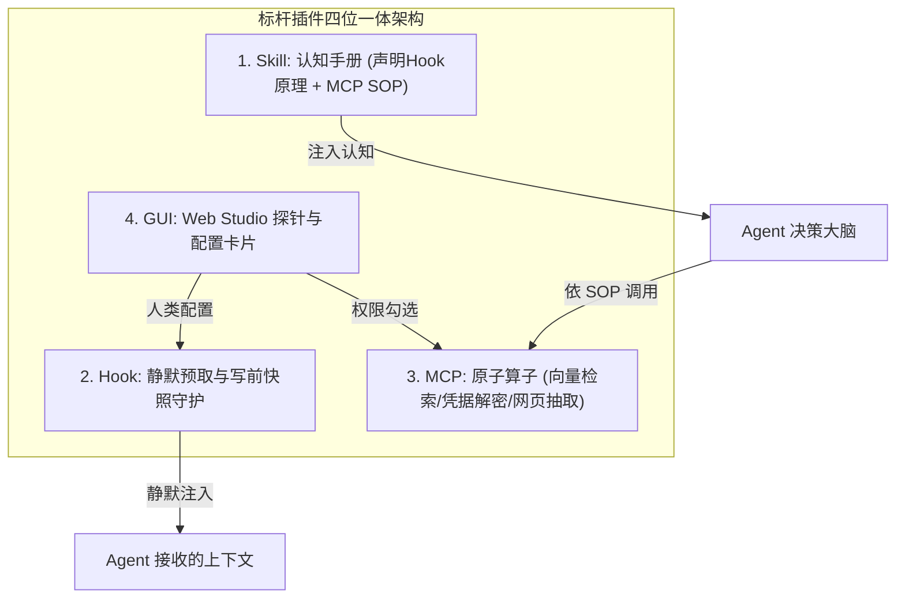
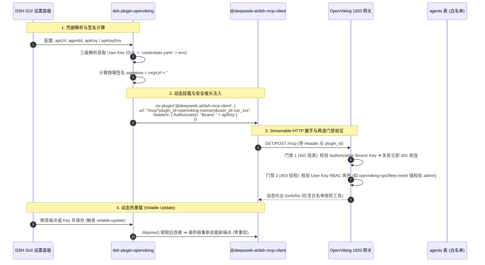

# 🏛️ OpenViking 插件中心与 Agent 生态工程研发与运维中枢 (Plugin Master Spec)

> **"From Client-Side Bloatware to Server-Centric Dynamic Capability Projection."**  
> 本技能是 OpenViking 插件生态、三大官方标杆插件 (KeePass凭据 / VK记忆 / 联网搜索)、插件制作与全生命周期运维的**统一物理架构与规范中枢 (SSOT)**。全系统异构智能体（DeepSeek Harness、Claude Desktop、Cursor、Antigravity、卫星集群）统一基于本规范互联同频。

---

## 📌 一、 核心物理第一性原理：服务端本体 + 客户端轻量桥梁

在现代体外大脑（Exocortex）架构中，必须坚决切除“给 Agent 赋予能力就必须把代码打包安装到客户端”的旧心智模型：

```text
┌────────────────────────────────────────────────────────────────────────┐
│                        真正的物理世界架构运作图                        │
├────────────────────────────────────────────────────────────────────────┤
│                                                                        │
│   【Wiki 服务器 / OpenViking 中枢 (插件本体 100% 在此运行)】           │
│   ┌──────────────────────────────────────────────────────────────┐     │
│   │ • 插件中心 (平台插件 & 用户插件)                             │     │
│   │   - 记忆检索/图谱/做梦/AST (openviking-memory, 47 项工具)     │     │
│   │   - KeePass 凭据库 (.kdbx 加密驱动, 10 项工具)               │     │
│   │   - 联网采集 (SearXNG + Crawl4AI, 2 项工具)                  │     │
│   │ • Agent 中心 (租户级权限路由器)                              │     │
│   │   - 记录: 每个 Agent 启用了哪些插件、勾选了哪些工具白名单    │     │
│   │   - 同步下发: 配套专属 Skill SOP 与激活对应 Hook 守护        │     │
│   └────────────────────────────────────────────────────────────┘     │
│                                  ▲                                     │
│                                  │ 单一通用桥梁 (极轻量 JSON/RPC 管道) │
│                                  ▼                                     │
│   【不同节点的各类客户端 (3070节点 / 2080Ti / Mac / DSH / Claude)】   │
│   ┌──────────────────────────────────────────────────────────────┐     │
│   │ 客户端电脑里【根本没有插件的真实代码】！                    │     │
│   │ 它装的所谓“插件”，其实只是一座【通信桥梁 (Proxy Stub)】：    │     │
│   │ 1. 握手问服务器：“我是 Agent A，我能用什么工具与配套技能？”  │     │
│   │ 2. 模型调工具时：“把这串参数发给服务器执行，拿回结果给模型” │     │
│   └────────────────────────────────────────────────────────────┘     │
│                                                                        │
└────────────────────────────────────────────────────────────────────────┘
```

1. **插件本体永远在服务器**：
   - 数据库读写、向量计算、AES-256 凭据解密、爬虫浏览器等重型逻辑与敏感数据，100% 运行于 OpenViking 服务端；
   - 客户端（DSH / Claude / Cursor）永远不需要安装复杂的 Python/Docker 环境。
2. **客户端永远只安装【单个不可变通用桥梁】**：
   - 客户端只需要安装一条标准化、无状态的轻量管道（如标杆 `dsh-plugin-openviking`）；
   - 连接端点绑定身份：`https://vk.tide.red/mcp?plugin_id=openviking-memory&user_id=usr_xxx`。
3. **动态能力投影 (Dynamic Capability Projection)**：
   - 当客户端握手发起 `tools/list` 时，服务端 FastMCP 网关根据该 Agent 的授权白名单，**动态下发工具定义**；
   - 用户在 Web Studio 勾选或禁用工具，**客户端零重新打包、零重新安装、秒级热生效**！

---

## 🧩 二、 插件四位一体架构与深度咬合铁律 (Quad-Model & Interlock SSOT) ⭐⭐⭐⭐⭐

> **核心哲学拷问**：  
> “光有 MCP，Agent 面对几十个凶器不知道怎么用，必然盲目调用、引发幻觉；  
> 光有 Hook，底层虽然自动处理了，但 Agent 不理解 Hook 原理，下意识又去调 MCP，造成‘左右互搏与重复浪费’；  
> 光有技能没有工具只是死文档；光有后台没有 GUI 人类两眼一抹黑。  
> **因此：Skill + Hook + MCP + GUI 四位一体紧密咬合，才是一个完整的生产级插件！**”

### 1. 插件四维物理职责矩阵

| 层次 (Layer) | 核心载体 | 生物学隐喻 | 承担的物理职责与核心契约 |
| :--- | :--- | :--- | :--- |
| **🧠 1. Skill (认知层)** | `SKILL.md` (SOP 指南) | **大脑 / 认知导轨** | **教 Agent “何时用、按何顺序用、绝不可怎么用”**。<br>在开头**必须交代 Hook 底牌**，明示 MCP 规范 SOP 与降级逻辑。 |
| **⚡ 2. Hook (拦截层)** | 生命周期钩子脚本 | **自主神经 / 条件反射** | **机器级、零 Token、确定性的自动化静默守护**。<br>在调用前预热注入上下文，调用后提纯教训，拦截阻断越权投毒。 |
| **🦾 3. MCP (工具层)** | FastMCP 协议算子 | **四肢 / 物理执行手** | **承担真实业务重活的原子接口**。<br>读写 SQLite、向量相似度检索、AES 解密、无头浏览器爬虫抽取。 |
| **👁️ 4. GUI (交互层)** | Settings Schema / Web Studio | **五官 / 驾驶舱视窗** | **人机交互、参数配置与观测视网膜**。<br>人类填写服务 URL、API Key、勾选开启哪些工具，查看健康探针。 |

### 2. 深度物理咬合与防冲突三大铁律 (The Anti-Conflict Laws)

1. **【交代底牌律 (Hook Transparency)】**：
   - 配套 Skill 开篇第一条必须向 Agent 明示当前 Hook 的静默行为：
   - *“例：本插件已激活 `ov_pre_invocation` 神经反射。在你收到 Prompt 前，系统已自动将最相关的核心记忆注入在上下文顶部。因此你**严禁开局无脑重复调用 find 盲搜**，避免浪费双倍 Token 与产生时延。”*
2. **【精密工序 SOP 律 (SOP Sequencing)】**：
   - 坚决杜绝让 Agent 自由瞎猜。Skill 必须给出确定性的调用状态机（如：“先查 outline 确认接缝 ➔ 若缺细节再 grep 精确定位 ➔ 修改前先调用 commit 快照 ➔ 严禁直接全量覆写”）。
3. **【权限隔离与优雅降级律 (Graceful Degradation)】**：
   - Skill 必须教会 Agent 理解 403 权限响应：当某 MCP 工具返回未授权时，属于租户白名单主动剥离，Agent 必须优雅回退，绝不陷入盲目重试死循环。

### 3. 云端权限物理剪枝与绝对真实探针铁律 (Zero-Leakage & Real Probing SSOT) ⭐⭐⭐⭐⭐

1. **【云端权限物理剪枝律 (Least-Privilege & Zero-Leakage)】**：
   - 云端 Web Studio 是唯一权限中枢；
   - 服务端在下发能力清单 (`/api/v1/system/client-capabilities`) 时，**必须在下发前完成物理剪枝过滤**；
   - 未被授权的高危或特权工具（如中枢运维工具 `write`、`edit`、`forget` 等），**绝对禁止出现在下发给客户端的 JSON Schema 中**；
   - 客户端仅能看到并操作已授权范围内的工具，彻底消灭客户端越权感知与越权勾选入口。
2. **【100% 绝对数据真实性探针律 (Absolute Data Integrity Probing)】**：
   - 连通性体检探针**绝对禁止任何硬编码假延迟与模拟 Mock 数据**；
   - 每一项探针必须真实发起底层调用并测量物理时间（如 SearXNG 本地网络探测、KeePass Argon2 KDF 安全解密物理开销约 1,000ms）；
   - 权限未授予时，探针必须真实返回 `403 Forbidden` 并在前端标红拦截，确保状态 100% 真实可信。
3. **【大模型 Tool-Calling 多插件排他律 (Tool Competition Handover)】**：
   - 异构客户端（如 DSH）部署时，**必须物理停用/卸载失效或欠费的官方同类扩展**；
   - 消除多插件概率性随机调用的冲突，杜绝首跳撞墙 `provider not registered`，保障自研矩阵 100% 独占流畅命中。

---

## 🏛️ 三、 三大官方标杆插件全息盘点 (The Big Three Quad Matrix)

全系统三大官方标杆插件按“四位一体”严格对照盘点如下：



| 标杆插件 ID | 1. Skill (认知脑) | 2. Hook (神经反射) | 3. MCP (执行手) | 4. GUI (驾驶舱) |
| :--- | :--- | :--- | :--- | :--- |
| **`dsh-plugin-openviking`**<br>(官方标杆通用 RPC 桥接插件 v1.5.0)<br>产物: `dsh-plugin-openviking-1.5.0.tgz` | **0 项随包规约**<br>(体外大脑 SSOT 统一管理)<br>• 插件纯为通用轻量 RPC 适配桥梁<br>• 不硬编码静态死技能<br>• 随 Agent 身份动态注入认知 | **3 项物理反射**<br>• `ov_pre_invocation`: 提问前静默召回核心记忆注入 Prompt 顶部<br>• `ov_lesson_crystallizer`: 答后离线提纯教训入库<br>• `ov_sandbox_guard`: 运行态越权与高危拦截 | **50 项 FastMCP 全量物理工具**：<br>• 34 项业务使用者工具 (知识读写/代码分析/AST测试/AIFP工单)<br>• 16 项中枢运维特权工具 (代码写改/死信自愈/流水线/硬件探针) | • DSH 客户端原生 GUI 配置表单<br>• `https://vk.tide.red/studio/dsh-plugin-openviking-1.5.0.tgz` 一键复制<br>• 支持机国内网 (1933) 与跨网公网双端点自适应切换 |
| **`keepass-vault`**<br>(KeePass 凭据中枢扩展) | **`keepass-vault`**<br>• 查库第一公理，严禁索要明文<br>• $\ge 20$ 位高熵密码生成契约<br>• 批量建号格式化落盘 SOP | **`vault_guard_hook`**<br>• **写前自动防抖物理快照** (`*.bak`)<br>• 敏感外呼自动注入动态凭据<br>• 外部未知网页物理熔断阻断 | **10 项凭据工具**：<br>• `keepass_get` (获取凭据)<br>• `keepass_search` (模糊查找)<br>• `keepass_add` (高熵新增)<br>• `keepass_analyze` (健康体检) | • `.kdbx` 保险箱路径配置<br>• 解锁状态安全指示灯<br>• 一键应急熔断开关<br>• 快照与备份日志视窗 |
| **`network-search`**<br>(联网搜索与采集扩展) | **`network-search-ops`**<br>• 搜索降级链 (SearXNG ➔ 爬取)<br>• 防爬死锁与超长截断规范<br>• 事实脱水与广告过滤 SOP | **`search_guard_hook`**<br>• 自动判定时效性意图并预热<br>• **外部网页污点标记 (Tainted)**<br>• 截断超大 Payload ($\le 8\text{KB}$) | **2 项采集工具**：<br>• `searxng_search` (免翻搜索)<br>• `crawl4ai_extract` (正文清洗) | • SearXNG 8888 容器健康瓦片<br>• Crawl4AI 抽取模式切换<br>• 搜索重试与超时阈值配置 |

---

## 🔒 三、 零信任单轨鉴权与空间用户双轴隔离铁律 (Zero-Trust & Dual-Auth SSOT) ⭐⭐⭐⭐⭐

> **芒格逆向审讯与第一性原理**：  
> “严禁搞‘本地内网免密码、公网远程要密码’的双轨割裂！本地免密不仅是伪安全漏洞，更是诱发‘本地测得绿、远端摔死崩’的罪魁祸首！全系统必须单轨零信任统一要求通信令牌；  
> 严禁搞所谓的‘免密只读访客通道 (Guest Mode)’！体外大脑是绝对私有的个人数字灵魂与机密资产，绝非公共维基，任何无 Key 请求一律物理阻断拒止；  
> 鉴权必须是空间（Tenant）+ 用户（Agent）双轴强绑定，通过 256-bit 高熵密钥实现数学级防碰撞，绝对杜绝跨空间同名用户串号越权！”

### 1. 零信任单轨鉴权公理 (Never Trust, Always Verify)
- **环境零特例**：无论主力机本地回路 (`127.0.0.1:1933`)、局域网 (`192.168.x.x`) 还是跨网公网域名 (`https://vk.tide.red`)，服务端统一执行单轨鉴权：**必须携带合法 Bearer Token**。
- **本地严禁免密特例**：本地开发与单测开局第一秒即必须携带合法凭据，不带立即 Fail-Fast，杜绝“本地正常、远端 401”的假象。

### 2. 体外大脑绝对私有封闭堡垒公理 (Private Exocortex SSOT)
- **100% 封闭私有**：体外大脑承载 ADR 架构底牌、KeePass 密码树、服务器拓扑、量化风控规则与踩坑教训，严禁向互联网提供任何未授权访问通道。
- **封杀 Guest 访客模式**：严禁搞任何“免密只读降级”。无 Key 物理拒止（0 响应、0 泄露、401 物理切断），新工兵与节点必须经管理员正式认主授权。

### 3. 空间 + 用户双轴强绑定防碰撞与防串号物理契约 (Tenant-User Dual Auth)
- **数学级防穷举碰撞**：User Key 必须由密码学安全随机数生成器 (CSPRNG) 生成 $\ge 256\text{-bit}$ 高熵令牌（搜索空间 $2^{256}$），物理抗穷举。
- **复合身份物理沙箱**：Key 底层强绑定 `(Account_ID, User_ID)` 唯一坐标。所有存储与向量检索严格沙箱化于 `viking://<Account>/<User>/...`；即使 A 空间与 B 空间均有同名 `worker`，底层物理分段隔离，绝不可能串号。
- **客户端双轴声明与服务端交叉阻断**：客户端请求 Header 声明 `X-Account-ID` 与 `X-Agent-ID`，服务端做双轴交叉强校验，不一致直接 `403 Forbidden` 阻断 IDOR 越权。

---

## 🛠️ 四、 插件制作标准技能指南 (Quad-Model Authoring SOP)

> **未来开发任何新插件的最高铁律**：  
> 新插件立项，必须自问四层：**MCP 是什么？Hook 怎么保护？Skill 怎么教 Agent？GUI 怎么给人类看？**  
> 坚决禁止只暴露几个裸 MCP 工具就草草宣布“开发完成”，四位一体齐备才叫插件！且 100% 仅在服务端开发，客户端零代码！

### 步骤 1：在服务端实现物理算子 (Server-Side MCP Tools)
在 OpenViking 服务端通过 FastMCP 暴露强类型、输入输出受控的原子工具算子：
```python
from mcp.server.fastmcp import FastMCP
from pydantic import BaseModel, Field

class ArticleExtractRequest(BaseModel):
    url: str = Field(..., description="目标网页或文章 URL")
    max_length: int = Field(8000, description="最大截断字符数")

@mcp.tool(name="wechat_extract_article")
def wechat_extract_article(req: ArticleExtractRequest) -> dict:
    """提取微信公众号文章正文并清洗为纯净 Markdown"""
    return {"status": "ok", "content": clean_content}
```

### 步骤 2：编写自动化切面与神经反射 (Defensive Hook)
实现该插件生命周期拦截器（如在提取前做 URL 白名单校验，提取后自动打上污点隔离标）：
```python
# hooks/wechat_guard.py
def before_extract(url: str):
    if not is_valid_article(url):
        raise ValueError("Invalid target")
```

### 步骤 3：编写配套专属认知手册 (Skill SOP) ⭐
在 `skills/wechat-extract/SKILL.md` 中编写操作手册，**第一条必须向 Agent 交代 Hook 原理与工具时机**：
```markdown
# 微信文章抓取认知导轨
1. 【交代底牌】：系统已激活 wechat_guard，外部链接已自动预校验。
2. 【调用时机】：仅在用户显式给出文章 URL 时调用；长文自动脱水，禁止反复抓取相同文章。
3. 【降级策略】：若返回 403 代表租户未授权，直接建议用户贴文本，严禁盲目重试。
```

### 步骤 4：内聚于 packages/plugins/<name>/ 物理构件并由扫描器 100% 动态反射 (Zero Hardcoding)
所有插件统一收敛于母港 `packages/plugins/<name>/`。`openviking/service/plugin_scanner.py` 会自动通过 AST 动态扫描抽屉 6 大 Tab，**坚决废黜在 `plugin_registry.py` 中维护任何静态硬编码字典**：
```text
packages/plugins/<name>/
├── plugin.json         # [1. 概览/6. 接入指引] 唯一版本源 SSOT、建议提示词、GUI 参数、集成命令模板
├── README.md           # [1. 概览] 纯净 Markdown 正文 (严禁内嵌死徽章与版本号)
├── skills/             # [2. 技能] 扫描 SKILL.md YAML Frontmatter (name, description, sop_summary)
├── server.py/tools.json# [3. MCP 算子] AST 动态扫描算子定义、参数 Schema 与中文分类
├── hooks.json          # [4. 钩子] 读取触发事件，并从 hooks/*.py 顶部 Docstring 提取守卫说明
├── rules/AGENTS.md     # [5. 规则] 自动扫描 rules/*.md 并注入智能体上下文
└── setup.py            # [安装] 自举安装向导，动态注入宿主注册表与 FastMCP 挂载
```

---

## ⚙️ 五、 插件运维标准技能指南 (Plugin Ops SOP)

### 1. 服务端健康度探活运维
* 插件中心必须具备物理探针：定期对 KeePass（是否锁闭）、SearXNG（8888 是否通畅）、Memory（SQLite/向量库）发起探活；
* 异常时在前端座舱优雅展示 `--` 或状态胶囊，坚决杜绝级联雪崩。

### 2. 客户端通用桥梁分发与严格 SemVer 运维 ⭐⭐⭐⭐⭐
客户端通用桥梁插件（如 `dsh-plugin-openviking`）本身的维护，严格遵循以下铁律：
* **Pack-Commit Atomic Lock**：发布前必须 Git Commit 物理落盘，严禁未提交直接打包；
* **Standalone Schema Bundle**：单文件 `schema.js` (34KB) 必须内联内嵌，确保 GUI SettingsForm 100% 渲染；
* **严格 SemVer X.Y.Z 物理契约**：
  * **X (MAJOR)**：仅在不兼容协议断代或架构级重写时升级；
  * **Y (MINOR)**：仅在新增了向后兼容的**实质性业务新特性/新视图**时升级；
  * **Z (PATCH)**：**日常排障、Bug修复、防御补丁、Volatile标注、生命周期释放 100% 只能且必须升级 Patch (如 1.5.0 ➔ 1.5.1)**！严禁滥用 Minor！
* **分发端点公网单一真实源**：统一固定为不可变端点 `https://vk.tide.red/studio/dsh-plugin-openviking-${VERSION}.tgz`。

---

## 🛡️ 六、 芒格逆向审讯：五道免死金牌防御矩阵 (Munger Inversion SSOT)

| 极端死因倒推 (Failure Mode) | 真实爆发场景与灾难 | 物理免死金牌 (Defensive Gatekeeper) |
| :--- | :--- | :--- |
| **1. 混淆代理人投毒**<br>(Confused Deputy) | 搜索插件抓到黑客网页，网页内嵌 Prompt 诱骗 Agent 调用 KeePass 偷密码回传公网。 | **【污点标记与单向熔断门禁】**：会话一旦吸纳外部未经清洗网页，立即标记 `tainted`，该会话周期内物理阻断任何凭据类工具！并在 Agent 中心对爬虫类 Agent 物理剥夺凭据权限！ |
| **2. 依赖断网与版本撕裂**<br>(Network Drift) | 3070 节点或机房内网无外网，npm 官方源超时卡死；或网关升级后客户端大面积 500 暴毙。 | **【自建源静态托管 + 协议自愈协商】**：以 OpenViking `/studio/*.tgz` 为 SSOT 分发源；网关端点必须支持老版本自适应向下兼容。 |
| **3. 远程凭据越权脱库**<br>(Remote Breach) | 远程 Agent 连上中枢后，顺藤摸瓜将宿主机上的私人总账密码库全部脱库。 | **【Local-First 就地自治 + 工具白名单】**：插件在谁的机器上就只读谁的本地数据库；严禁跨机偷库，未授权 Agent 连 `keepass_get` 的定义都看不到。 |
| **4. Hook 备份风暴与延迟雪崩**<br>(Latency Stacking) | 批量注册 50 个账号连续触发 50 次物理拷贝；每次调用都同步跑大模型，延迟飙至 10 秒。 | **【快照防抖合并 + 异步非阻塞切面】**：10 秒内的连续写入合并为单次快照；日志审计与经验提纯全量扔进异步后台协程，读操作 0.01ms 瞬时放行。 |
| **5. 人机锁屏心智脱节**<br>(Lockscreen Illusion) | 人类在 Windows 上锁定了 KeePass，后台 Linux 的 `vault.env` 却依然在无阻断解密读写。 | **【内存短暂令牌 (Ephemeral Token)】**：提供一键应急熔断开关 (Kill-Switch)，检测锁屏心跳立即清空内存解密缓存。 |

---

## 🔐 七、 异构客户端认证鉴权与 RPC 桥梁全链路时序契约 (Auth & RPC Bridge SSOT) ⭐⭐⭐⭐⭐

以标杆 **DeepSeek Harness (DSH)** 客户端为例，客户端与 OpenViking 1933 网关之间的认证鉴权与动态流转机制严格遵循以下物理契约：



### 1. 核心第一性原理：认证与授权双轨分离 (Authentication vs Authorization)
* **User Key (用户凭据 / API Key) 负责【身份验真 (Authentication)】**：
  * 证明“你是哪个合法的租户/人类用户”；
  * 如果密钥错误或缺失，服务端第 1 道门禁直接拦截，返回 `HTTP 401 Unauthorized`。
* **User Key 与插件包负责【权限范围与能力投影 (Authorization)】**：
  * 工具能力与插件包 1:1 强绑定（Memory 34 tools, Ops 17 tools, Fleet 2 tools）；
  * 网关根据 User Key 的角色 (admin vs user) 执行 RBAC 门禁，非 admin 访问 Ops/Fleet 立即 403 Forbidden 物理拦截。

### 2. DSH 客户端三级凭据自动探测链 (Triple Resolution Chain)
在 `dsh-plugin-openviking` 的 `index.js` 中，User Key 严格按以下优先级无感读取：
1. **优先 1：GUI SettingsForm 直接配置**：
   * `Config.apiKey`（定义为 `v(Schema.string().role('secret').default(''))`），在 DSH 设置面板带密码圆点遮罩直接输入，随配置落盘；
2. **优先 2：DSH 官方凭据保险库 (`.credentials.yaml`)**：
   * 遵循 DSH 官方最佳实践，通过 `Config.apiKeyEnv`（默认 `OPENVIKING_API_KEY`）键名，自动扫描并解析 `~/.dsh/.credentials.yaml` 中的明文密钥；
3. **优先 3：宿主机操作系统环境变量**：
   * 兜底读取 `process.env[apiKeyEnv]`。

### 3. RPC 桥梁安全传递三契约
1. **路由与角色走 Query 参数**：
   * `url: ${api}/mcp?plugin_id=${pluginId}&user_id=${encodeURIComponent(userId)}`
   * 告诉网关本次连接代表谁、需要投影哪份工具白名单；
2. **敏感凭据绝不走 URL，严格走 HTTP Header**：
   * `headers: { 'Authorization': 'Bearer ' + key, 'X-OpenViking-Actor-Peer': peer }`
   * 严禁将 API Key 拼进 URL 中，彻底避免被反向代理（如 Nginx / FRP）的 Access Log 打印泄密！
3. **签名监听与零重启热生效 (Volatile Hot-Reload)**：
   * 插件内部维护 `signature = ${mcpUrl}#${key || 'nokey'}`；
   * 监听 DSH 原生 `loader/volatile-update` 事件；
   * 当用户在 DSH 设置界面修改了端点或 Key 并点击【保存】时，插件检测到签名变更，立即调用 `currentMcpFork.dispose()` 优雅销毁旧客户端，并在 50ms 内使用新端点重新挂载，**智能体工具秒级切换，用户零感知、零重启客户端软件**！

---

## 🧪 八、 新 Agent / 节点接入全能力闭环验收测试 (Onboarding SSOT)

> 💡 **六阶矩阵验收测试规范详见**：[`references/AGENT_PLUGIN_ONBOARDING_TEST_SOP.md`](file:///c:/Users/Skl/Desktop/Workspace/coding/OpenVikingStudio/packages/plugins/openviking-memory/skills/openviking-plugin-ops/references/AGENT_PLUGIN_ONBOARDING_TEST_SOP.md)。
> 核心准入铁律：单一变量隔离 ➔ 工具连通测试 ➔ 双向数据闭环 ➔ 生产发布门禁。

## 🧪 十、 技能自动化准入四阶流水线规约 (Ingestion SSOT)

> 💡 **自动化准入规范详见**：[`references/AUTONOMOUS_INGESTION_SOP.md`](file:///c:/Users/Skl/Desktop/Workspace/coding/OpenVikingStudio/packages/plugins/openviking-memory/skills/openviking-plugin-ops/references/AUTONOMOUS_INGESTION_SOP.md)。
> 核心四阶流水线：投递 (`submit`) ➔ 校验 (`Validator`) ➔ 结晶 (`AutoCrystallizer`) ➔ 入籍 (`COMMITTED`)。严禁手工文件拷贝！

## 🚀 九、 插件统一公用源修改与单向拉取部署标准 SOP (Pull-Only Deployment SSOT) ⭐⭐⭐⭐⭐

> **核心第一性原理 (2026-10-19 铭刻)**：  
> “所有的插件以后修改的时候不允许改本地，只允许改线上统一、公用的插件。改完的插件重新在本地拉取，而不是直接去各个智能体手动去修改。这个插件你连到10000人的电脑上去修改吗？”  
> 坚决切除在端侧 `~/.gemini/config/plugins/` 运行时目录打猴子补丁、以及人工逐机 SSH 维护的作坊式灾难。全系统遵循**【唯一源统一修改 ➔ 规范发版推流 ➔ 客户端单向一键拉取安装】**的工业级流水线！

### 1. 唯一源修改与发版四步闭环 (The 4-Step SSOT Modification Loop)

1. **唯一修改源物理定位 (Kernel SSOT)**：
   - **全域插件唯一母港内核**：`packages/plugins/<plugin-name>/`
   - **严禁**：在任何宿主的 `~/.gemini/config/plugins/` 运行目录下直接打本地猴子补丁！
   - **三大端适配层动态投影**：
     • 反重力：`packages/plugins/<name>/setup.py`
     • DSH 客户端：`scripts/assemble_dsh_adapter.py` -> `client.js` + `index.js`
     • VK 插件中心：`openviking/service/plugin_scanner.py` 100% 动态反射物理文件
2. **规范版本升阶 (Strict SemVer Bump)**：
   - 在 `plugin.json` 或 `package.json` 中自增 SemVer 版本（日常排障必须升级 Patch，如 `2.0.11` ➔ `2.0.12`）；
   - 反重力插件同步核验 `hooks.json` 动态渲染逻辑（绝对路径 + `-E -s -S` 隔离）；
3. **安全门禁与本地验证 (Security & Retina Gate)**：
   - 必须通过 Git Pre-Commit Hook 安全审计（Zero Secrets，严禁硬编码任何真实 Key）；
   - 执行标准化构建与测试（`pytest` / `setup.py --inspect`）；
4. **统一推流发布 (Push to SSOT)**：
   - 执行 `git commit` 并 `git push origin main` 推流至线上统一仓库，正式建立不可变版本留痕。

### 2. 客户端单向一键拉取部署规范 (One-Line Pull Deployment)

任何节点（本地 2080Ti、远程 3070、MacBook M3 或未来 10,000 个使用者的终端）需要更新插件时，**绝对禁止人工穿刺魔改**，必须统一通过标准拉取命令部署：

- **反重力客户端 (Antigravity IDE / Desktop)**：
  ```powershell
  # 统一拉取与标准自举安装命令：
  python packages/plugins/<plugin-name>/setup.py --install
  ```
- **DSH 客户端 (DeepSeek Harness)**：
  从 Web Studio 静态分发端点重新获取发布包：
  ```bash
  curl -fsSL https://vk.tide.red/studio/dsh-plugin-<name>-${VERSION}.tgz -o dsh-plugin.tgz
  ```
- **绝对禁令**：严禁 AI 或人类通过 SSH 登录多台电脑逐台打开编辑器手工改代码！

---


## 🧪 九、 历史演进教训库与避坑索引 (Evolution Lessons Index)

> 💡 **完整教训档案详见**：[`references/EVOLUTION_LESSONS.md`](file:///c:/Users/Skl/Desktop/Workspace/coding/OpenVikingStudio/packages/plugins/openviking-memory/skills/openviking-plugin-ops/references/EVOLUTION_LESSONS.md)（含 16 项历史高危避坑复盘）。
> 核心三铁律摘要：1) 零信任单轨鉴权；2) 客户端单向一键拉取部署；3) 技能入库严禁手工拷贝强制走官方流水线。

## 🛡️ 七、 MCP 端侧代理自省数据闭环与轻量 Hook 旁路规范 (v3.3.0)

### 1. 第一性原理：自省工具必须数据闭环 (Self-Contained Contract)
- **严禁代偿性探查**：严禁让通用 Agent 在自检时因缺少 `api_endpoint`、`plugin_version` 等环境变量去自由调用 Shell 探查磁盘；
- **端侧 Proxy 拦截增强**：客户端代理进程（Python `server.py` 或 Node `mcp-proxy-core.mjs`）直接持有当前生效的本地配置，必须在 `tools/call` 拦截 `whoami` 与 `health`，动态注入真实生效端点与版本号；
- **确定性降级容灾**：在上游网络抖动或远端 500/400 时，`whoami` 依然能够安全返回本地脱敏凭据与状态，绝不抛出 RPC 异常诱发 Agent 代偿性盲翻。

### 2. 自检轻量交互 Hook 旁路降噪铁律 (Zero Hallucination Priming)
- **毫秒级旁路静默**：Pre-invocation Hook 必须对带有 `自检`、`health`、`whoami`、`selfcheck` 等自省关键词的指令执行旁路静默 (`emit_json({})`)；
- **防上下文投毒**：严禁向自检上下文注入历史重度测试报告或巨石演进教训，严格消灭《死穴 15：Token 膨胀与上下文投毒》。