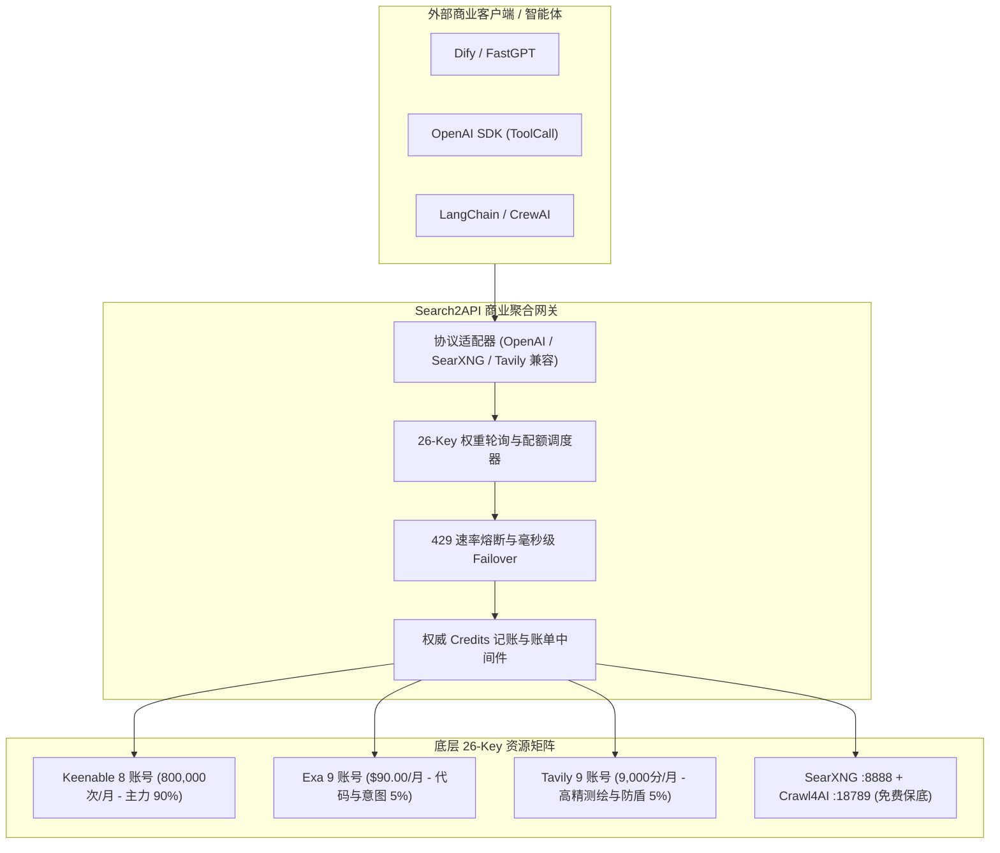

# 联网搜索与网页采集聚合中枢认知导轨 (network-search v1.1.2)

## 一、五路引擎物理矩阵与底牌全景 (SSOT)

| 引擎 | 账号与配额池 | 核心物理特长 | 权威计费规则 (Credits) | 保底与降级次序 |
|:---|:---|:---|:---|:---|
| **Keenable** | 8 账号 / 每月 800,000 次 | NEEDLE 5大垂直检索、Scholar/Finance/Legal 深度提权 | 响应头 `x-credit-cost`，标准 1.0 次/调用 | 第一梯队 (海量宽幅与垂类打底) |
| **Exa** | 9 账号 / 每月 $90.00 额度 | 神经语义嵌入、GitHub 开源仓库定位、Agent 调研 | 响应体/头 `cost`，标准 $0.004/搜，$0.005/答 | 第二梯队 (语义意图与代码反查) |
| **Tavily** | 9 账号 / 每月 9,000 积分 | Advanced 交叉核验、Map 站点拓扑测绘、Extract 免爬脱水 | 响应体 `credits`，基础 1.0，高级 2.0，提取 1.0/5url | 第三梯队 (高精交叉与防盾测绘) |
| **SearXNG** | 本地 `:8888` 常驻服务 | 45+ 引擎聚合、免翻高速、百度去广告 | 物理免费 (0.0 credits) | 第四梯队 (本地私有保底) |
| **Crawl4AI** | 本地 `:18789` Playwright | 无头动态渲染、JS 执行、CSS 选择、长文脱水 | 物理免费 (0.0 credits) | 重型动态无头渲染 |

---

## 二、官方协议对齐与四大排查避坑铁律

1. **Keenable 必须使用 `max_results` (严禁使用 `num`)**：
   - 官方端点：`POST https://api.keenable.ai/v1/search`，请求头 `X-API-Key: <key>`；
   - 严禁传入 `num` 参数，否则官方网关 100% 拒绝并报 `400 Bad Request`；必须统一使用 `max_results`；
   - NEEDLE 是官方 5 大垂直评估基准（Scholar, Finance, Legal, News, Rare），已收敛为垂直专家检索 `search_vertical_expert`，使用 `mode="pro"` 配合垂类 Prompt 提权。

2. **Exa 调研长任务必须使用 `POST /agent/runs` (严禁使用 `/research`)**：
   - 旧端点 `https://api.exa.ai/research` 已被官方彻底废除并报 `410 Gone`；
   - 官方最新 Agent 调研端点为 `POST https://api.exa.ai/agent/runs`，入参格式为 `{"query": "...", "effort": "auto"}`；
   - Agent 调研属深度多步长任务，客户端超时必须配置为 $\ge 60\text{s}$。

3. **Tavily 必须强制在 HTTP Header 携带 `Authorization: Bearer <key>`**：
   - 官方端点 `/map` 和 `/crawl` 强制在 HTTP Header 校验 Bearer Token；若仅在 JSON body 传递 `api_key` 会被网关拦截报 `401 Unauthorized`；
   - 客户端所有请求头必须固定注入 `headers["Authorization"] = f"Bearer {key}"`。

4. **Crawl4AI 必须注入 Token 并由 systemd 固化微网关守护**：
   - 本地 Docker 启用了鉴权，请求头必须携带 `Authorization: Bearer <token>`；
   - 微网关通过 `/etc/systemd/system/crawl4ai-search-gateway.service` 监听 18792 端口，设置 `Restart=always` 避免进程退出导致 SearXNG 穿透爬虫瘫痪。

---

## 三、运行态数据安全与资产隔离规范

1. **绝对切除 KeePassXC 导入依赖**：
   - 运行态绝不依赖 KeePassXC，Key 矩阵统一收口于服务端安全配置文件（`~/.openviking/data/search/search_keys.json`，权限 `600`）；
   - 严禁在代码、日志中回显明文 API Key，仅显示 8 位 SHA256 脱敏指纹（如 `kb_899872a3`, `exa_d0fd541d`, `tv_1lQI1jVY`）。

2. **调用必落地 search_key_usage 流水账**：
   - 每次调用优先从官方响应体/响应头捕获权威 credits；
   - 若官方未回传，按官方发布基准计费，杜绝粗糙毛估；
   - 日志标准化脱敏打标：`[SEARCH_KEY_USAGE] fp={key_fp} engine={engine} tool={tool} status={code} credits={credits}`。

3. **数据库防爆炸与 45 天滚动归档物理清理**：
   - 45 天以内的调用记录保留实时明细流水；
   - 超过 45 天的明细记录自动按日聚合归档写入 `search_key_daily_summary`；
   - 归档后物理删除 45 天前明细（`DELETE FROM search_key_usage WHERE created_at < datetime('now', '-45 days')`）。

---

## 四、12 项原子 MCP 工具 (Tools) 目录

1. `web_search`: 多路宽幅自适应检索 (Keenable ➔ Tavily ➔ SearXNG)；
2. `search_neural`: Exa 语义嵌入神经网络意图检索；
3. `search_qna`: Tavily QnA / Exa 权威解答与引用生成；
4. `search_deep`: Tavily Advanced 深度多源交叉检索；
5. `search_code_context`: Exa GitHub 开源上下文与仓库定位；
6. `search_similar_repos`: Exa findSimilar 竞品与同类反查；
7. `map_site`: Tavily Map 站点拓扑树测绘 (支持 instructions 语义过滤)；
8. `extract_urls`: Tavily/Exa 免爬虫快速正文脱水抽取；
9. `tavily_crawl`: Tavily Map + Extract 整站自动化爬行流水线；
10. `crawl_local`: 本地 Crawl4AI 18789 Playwright 动态无头渲染；
11. `deep_research`: Exa Agent 多步自主调研长报告 (POST /agent/runs)；
12. `search_vertical_expert`: Keenable NEEDLE 5大垂类高精专家检索 (含 `benchmark_needle` 兼容别名)。

---

## 五、Search2API 商业化聚合网关与额度变现架构规范 (Commercial SSOT)

借鉴 CPA2API 的多 Provider 别名 Failover 与配额分摊设计思想，将全集群 26 个官方免费账号（每月 80万+ 次）聚合转化为商业化对外服务：

1. **统一协议兼容层**：
   - 对外暴露 `/v1/chat/completions` (OpenAI ToolCall 格式)；
   - 对外暴露 `/search?q={query}&format=json` (SearXNG 格式，零适配集成进 Dify)；
   - 对外暴露 `POST /api/v1/search` (Tavily 格式，兼容各种开源 Agent 框架)。
2. **多 Key 轮询与故障转移**：
   - 8 个 Keenable 账号各自拥有 100,000 次/月，按剩余配额加权轮询；
   - 遭遇单 Key 429 或配额耗尽，0.1ms 级自动切换同 Provider 的下一个 Key 重试；
   - 全 Provider 宕机时优雅降级至本地 SearXNG 8888，对外 99.99% 高可用 SLA。
3. **商业化定价与套利**：
   - 官方单价通常为 $0.005 ~ $0.01 / 次，我们拥有每月 800,000+ 次免费额度；
   - 对外按 ¥10 / 10,000 次 或 ¥50 / 100,000 次 提供商业 API Key 订阅，毛利率接近 100%。
